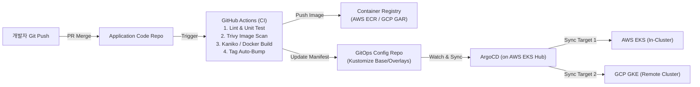
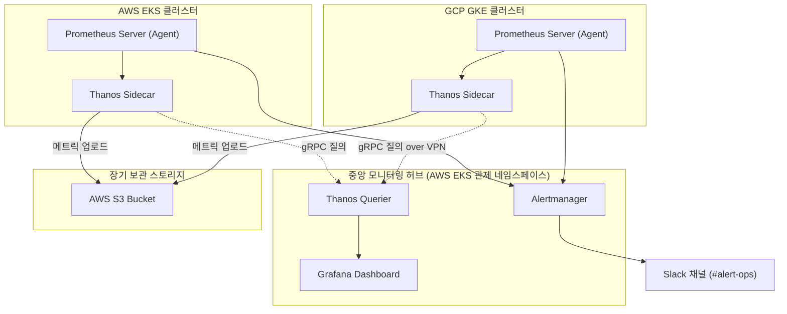

# 멀티클라우드 고가용성 아키텍처 독립 설계 보고서

**설계자**: Antigravity  
**작성일**: 2026년 11월 06일  
**문서 상태**: 제안서 초안 (Final Proposal)  

---

## 1. 한 줄 요약 / 설계 철학

> **"AWS Active - GCP Warm Standby 기반의 실용적 무중단 페일오버 아키텍처: 불필요한 분산 트랜잭션 오버헤드를 배제하고, 실시간 비동기 CDC와 GitOps 멀티 클러스터 제어로 비용과 안정성을 동시에 확보한다."**

### 설계 철학
1. **현실적 구현 및 검증 가능성 (Pragmatic Feasibility)**  
   아무리 이론적으로 완벽한 아키텍처라도 한정된 기간과 인력으로 구현하지 못하면 가치가 없습니다. 본 설계는 4인의 부트캠프 팀이 6주 내에 100% 코드로 프로비저닝(IaC)하고, 실제 심사위원 및 평가자 앞에서 **'3분 내 클라우드 장애 주입 및 무중단 페일오버'**를 라이브로 시연할 수 있는 구체적이고 검증된 기술만을 채택합니다.
2. **비용 효율성과 Egress 트래픽 통제 (Cost & Egress Awareness)**  
   상시 멀티클라우드 액티브-액티브(Active-Active)는 양방향 분산 DB 복제와 데이터 송신료(Egress)로 인해 학생 예산을 단기간에 소진시킵니다. 평상시에는 검증된 메인 클라우드(AWS)에서 100% 트래픽을 처리하고, 보조 클라우드(GCP)는 최소 사양(Pilot Light / Warm Standby)으로 유지하여 월 200달러 미만의 비용 통제를 달성합니다.
3. **단순함이 만드는 복원력 (Resilience through Simplicity)**  
   복잡한 2-Phase Commit이나 글로벌 분산 합의 알고리즘(Spanner, CockroachDB 등) 대신, **Cloudflare GSLB 헬스체크 + PostgreSQL 논리적 복제(Logical Replication) + ArgoCD GitOps 동기화**라는 표준 패턴을 채택하여 장애 포인트(SPOF)와 운영 복잡도를 극소화합니다.

---

## 2. 가정 (Assumptions)

사용자 미정 사항에 대해 부트캠프 프로젝트의 특성을 고려하여 다음과 같이 합리적 가정을 수립했습니다.

| 구분 | 가정 내용 | 수립 근거 |
| :--- | :--- | :--- |
| **팀 규모** | **총 4명** (인프라/IaC 1명, K8s/네트워크 1명, CI/CD/GitOps 1명, 백엔드/모니터링 1명) | 부트캠프 최종 프로젝트의 전형적인 팀 구성이며 1인 1영역 집중 가능 |
| **기간** | **총 6주** (기획 1주, IaC 1주, K8s/네트워크 1주, CI/CD 1주, 모니터링/장애검증 1주, 리허설 1주) | 엔드투엔드 구축과 데모 시나리오 완성을 위한 표준 스프린트 기간 |
| **예산** | 개발 기간 **월 $150 내외**, 부하/DR 테스트 기간(2주) **월 환산 $300~$350 이내** | 학생 크레딧 및 프리티어, Spot 인스턴스, 스케줄링 절감을 고려한 현실적 한도 |
| **서비스 도메인** | **"실시간 좌석 예약 및 티켓 커머스 (TicketFlow)"** | - 3Tier 구조와 MSA 도메인 분리가 명확함<br>- 동시성 트래픽 및 데이터 정합성(좌석 중복 결제 방지)이 중요하여 고가용성 아키텍처의 가치를 극적으로 증명 가능 |
| **클라우드 리전** | AWS 서울(`ap-northeast-2`) & GCP 서울(`asia-northeast3`) | 양 클라우드 간 물리적 거리 최소화로 네트워크 지연(RTT 2~4ms) 및 복제 랙 극소화 |

---

## 3. 전체 아키텍처

전체 아키텍처는 **Cloudflare GSLB**를 최상단에 두고, 주 서비스 리전인 **AWS 서울**과 재해복구(DR) 리전인 **GCP 서울**이 **IPsec VPN**으로 상시 연결된 3Tier 구조입니다.

```mermaid
flowchart TD
    subgraph Client["사용자 계층 (Clients)"]
        User["사용자 웹/모바일 브라우저"]
    end

    subgraph GlobalDNS["GSLB / 엣지 라우팅 계층"]
        CF["Cloudflare Load Balancer (GSLB)<br/>- Anycast DNS & 5초 주기 Health Check<br/>- Primary: AWS ALB (Weight 100)<br/>- Fallback: GCP GLB (Weight 0)"]
    end

    subgraph AWS["메인 클라우드: AWS 서울 리전 (ap-northeast-2) - ACTIVE (100% 트래픽)"]
        direction TB
        subgraph AWS_Web["Web Tier"]
            ALB["AWS Application Load Balancer (Public Subnet)"]
        end

        subgraph AWS_App["App Tier (EKS Cluster: v1.31)"]
            Ingress_AWS["AWS Load Balancer Controller (Ingress)"]
            Auth_AWS["Auth Service Pods (HPA)"]
            Ticket_AWS["Ticket/Catalog Pods (HPA)"]
            Order_AWS["Order/Payment Pods (HPA)"]
        end

        subgraph AWS_Data["Data Tier"]
            RDS_Primary[("Amazon RDS PostgreSQL 16<br/>Multi-AZ Primary (2a)")]
            RDS_Standby[("Amazon RDS Standby<br/>(2c - 동기식 자동복구)")]
            Redis_AWS[("In-Cluster Redis<br/>(세션 & 좌석 선점 캐시)")]
        end
    end

    subgraph Interconnect["클라우드 간 사설 통신망"]
        VPN["Site-to-Site IPsec VPN Tunnel<br/>(AWS VGW ↔ GCP Cloud HA VPN)"]
    end

    subgraph GCP["보조 클라우드: GCP 서울 리전 (asia-northeast3) - WARM STANDBY (대기/DR)"]
        direction TB
        subgraph GCP_Web["Web Tier"]
            GLB["GCP External HTTP(S) LB (Public Subnet)"]
        end

        subgraph GCP_App["App Tier (GKE Cluster: v1.31)"]
            Ingress_GCP["GKE Ingress (Nginx / GKE Gateway)"]
            Auth_GCP["Auth Pods (Min 1 replica)"]
            Ticket_GCP["Ticket Pods (Min 1 replica)"]
            Order_GCP["Order Pods (Min 1 replica)"]
        end

        subgraph GCP_Data["Data Tier"]
            CloudSQL_Replica[("GCP Cloud SQL PostgreSQL 16<br/>(Logical Replica / Standby)")]
            Redis_GCP[("In-Cluster Redis<br/>(Warm Standby 캐시)")]
        end
    end

    subgraph Ops["운영 및 배포 계층 (Ops & CI/CD)"]
        GH["GitHub Actions (CI Engine)"]
        ArgoCD["ArgoCD GitOps Engine<br/>(AWS EKS Hub → GKE Remote Cluster 관리)"]
        PrometheusStack["Thanos & Prometheus Stack<br/>(멀티 클러스터 통합 메트릭 수집)"]
    end

    %% 트래픽 흐름
    User -->|1. HTTPS 질의| CF
    CF -->|2. 평상시 정상 트래픽 (100%)| ALB
    CF -.->|2-1. AWS 장애 시 페일오버 트래픽| GLB

    ALB --> Ingress_AWS
    Ingress_AWS --> Auth_AWS & Ticket_AWS & Order_AWS

    GLB --> Ingress_GCP
    Ingress_GCP --> Auth_GCP & Ticket_GCP & Order_GCP

    Order_AWS -->|Write/Read| RDS_Primary
    Ticket_AWS -->|Read/Cache| Redis_AWS
    RDS_Primary -.->|동기 복제| RDS_Standby

    %% 데이터 동기화
    RDS_Primary ==="비동기 논리적 복제 (Logical CDC over VPN)"===> VPN ===> CloudSQL_Replica

    %% Ops 흐름
    GH -.->|컨테이너 이미지 빌드 & ECR/GAR 푸시| Ops
    ArgoCD -.->|GitOps 배포| AWS_App
    ArgoCD -.->|GitOps 배포| GCP_App
    PrometheusStack -.->|메트릭 스크랩| AWS_App & GCP_App
```

---

## 4. AWS/GCP 역할 분담과 그 이유

### 선택한 구조: AWS Primary Active - GCP Warm Standby (Pilot Light+)

| 클라우드 | 운영 모드 | 트래픽 비중 | 주요 인프라 리소스 | 역할 |
| :--- | :--- | :--- | :--- | :--- |
| **AWS** | **Active (Primary)** | **100%** | EKS (HPA 적용), RDS Multi-AZ, ALB | 모든 사용자 프로덕션 트래픽 수용 및 쓰기/읽기 전담 |
| **GCP** | **Warm Standby (DR)** | **0% (장애 시 100%)** | GKE (파드 최소 1개 유지), Cloud SQL Replica, GLB | 실시간 DB 복제본 유지, AWS 전체 장애 시 즉시 트래픽 승격 |

### 의사결정 근거 및 대안 비교

1. **왜 '상시 멀티클라우드 액티브-액티브(Active-Active)'를 배제했는가?**
   - **데이터 지연(Latency)과 분산 트랜잭션 한계**: AWS와 GCP 리전이 모두 서울에 위치하더라도 VPN/전용회선 경유 시 RTT는 2~5ms가 소요됩니다. MSA 환경에서 하나의 주문 요청이 4~5회의 DB 쿼리를 유발할 경우, 크로스 클라우드 통신으로 인해 응답 지연이 20~30ms 이상 누적됩니다.
   - **Split-Brain 및 정합성 리스크**: 양쪽 DB에 동시에 쓰기(Multi-Master Write)를 허용하려면 CockroachDB나 Spanner 같은 분산 트랜잭션 DB가 필수적입니다. 이는 부트캠프 팀이 감당하기 어려운 운영 난이도와 막대한 비용을 발생시키며, 네트워크 단절 시 데이터 불일치가 발생합니다.
   - **Egress 비용 폭탄**: 상시 액티브-액티브는 서비스 간 통신과 DB 동기화로 인해 클라우드 간 데이터 전송 요금(AWS 아웃바운드 $0.09/GB, GCP $0.12/GB 수준)이 상시 발생합니다.

2. **왜 '서비스별 분담(예: AWS는 주문, GCP는 검색/추천)'을 배제했는가?**
   - 서비스별 배치는 '멀티클라우드 고가용성(DR)'이 아닌 단순 '분산 배치'입니다. AWS 리전 전체에 장애가 났을 때 핵심 기능인 주문/결제가 마비된다면 멀티클라우드를 도입한 목적인 **비즈니스 연속성**을 입증할 수 없습니다.

3. **Active-Warm Standby의 장점**
   - 평상시 AWS 단일 클러스터 내에서 로컬 고속 통신(지연시간 < 1ms)으로 최고의 성능을 제공합니다.
   - GCP는 최소 노드/파드로만 대기하므로 비용을 극적으로 절감(Pilot Light)할 수 있습니다.
   - 데모 발표 시 AWS ALB를 임의로 차단했을 때 **"3분 내에 GCP로 완전히 넘어가 정상 동작하는 모습"**을 극명하고 직관적으로 시연할 수 있습니다.

---

## 5. 3Tier 상세 설계 및 데이터 동기화

### 1) Web Tier
- **진입점**: Cloudflare Load Balancing (GSLB)이 전면에 위치하여 Anycast 네트워크를 통해 클라이언트 요청을 수신합니다.
- **클라우드별 수신**:
  - AWS: AWS ALB (Application Load Balancer)가 Public Subnet에 위치하며, TLS/SSL 종단 및 AWS WAF 기본 룰(DDoS, SQLi 방어)을 적용합니다.
  - GCP: Cloud Load Balancing (External HTTP(S) LB)이 대기하며, 동일한 SSL 인증서와 헬스체크 엔드포인트(`/healthz`)를 구성합니다.

### 2) App Tier (쿠버네티스 MSA 서비스 분할)
티켓팅 및 이커머스 도메인을 고려하여 3개의 핵심 마이크로서비스로 분할합니다.

| 서비스명 | 주요 책임 | DB 접근 특성 | AWS 인스턴스 전략 | GCP 대기 전략 |
| :--- | :--- | :--- | :--- | :--- |
| **User/Auth Service** | 회원 관리, JWT 토큰 발급, 인증/인가 | 읽기 80%, 쓰기 20% | HPA (Min 2, Max 6) | Min 1 Replica 유지 |
| **Catalog/Ticket Service** | 공연/티켓 상품 조회, 좌석 배치도 제공 | 읽기 95%, 쓰기 5% (캐시 위주) | HPA (Min 2, Max 10) | Min 1 Replica 유지 |
| **Order/Payment Service** | 실시간 좌석 예약, 결제 검증, 주문 생성 | 쓰기 70%, 트랜잭션 집중 | HPA (Min 2, Max 8) | Min 1 Replica 유지 |

- **파드 스케일링 정책**:
  - AWS: 트래픽에 따라 Kubernetes Horizontal Pod Autoscaler(HPA)가 CPU 70% 초과 시 자동 증설.
  - GCP: 평상시 리소스 낭비를 막기 위해 서비스당 1개의 파드만 Warm 상태로 유지하며, 트래픽 유입 시 즉시 30~60초 내에 스케일아웃되도록 설정.

### 3) Data Tier & 멀티클라우드 데이터 동기화
- **AWS Primary Data Tier**:
  - **Amazon RDS for PostgreSQL 16 (Multi-AZ)**: 가용영역 2a(Primary)와 2c(Standby)에 걸쳐 동기식 복제로 구성되어 단일 AZ 장애를 자체 커버합니다.
  - **In-Cluster Redis (Bitnami Helm)**: 매니지드 ElastiCache 비용 절감을 위해 K8s 내부 StatefulSet으로 배포하여 좌석 임시 선점(TTL 5분) 및 세션 캐시로 활용합니다.
- **GCP Standby Data Tier**:
  - **GCP Cloud SQL for PostgreSQL 16**: 독립 인스턴스로 생성되어 대기.
- **멀티클라우드 데이터 동기화 메커니즘**:
  - **PostgreSQL 논리적 복제 (Logical Replication)** 사용:
    1. AWS RDS PostgreSQL에서 `rds.logical_replication = 1` 파라미터 활성화.
    2. 주문, 티켓, 사용자 핵심 테이블에 대한 `PUBLICATION` 생성.
    3. IPsec VPN 터널을 통해 GCP Cloud SQL에서 해당 발행을 구독(`SUBSCRIPTION`).
    4. WAL(Write Ahead Log) 기반 비동기 스트리밍 방식으로 지연시간(Replication Lag)은 서울 리전 간 100ms~500ms 수준으로 유지.

```
[AWS RDS PostgreSQL (Publisher)]
       │ (WAL Event Stream)
       ▼
 [IPsec VPN Tunnel (10.100.0.0/16 ↔ 10.200.0.0/16)]
       │
       ▼
[GCP Cloud SQL (Subscriber / Read-Only Standby)]
```

### 4) 동기화의 한계와 트레이드오프
- **한계 1 (DDL 비동기화)**: PostgreSQL 논리적 복제는 DML(`INSERT`, `UPDATE`, `DELETE`)만 복제하며 `ALTER TABLE` 등 DDL은 자동 전파되지 않습니다.
  - *해결책*: Flyway 또는 Liquibase를 CI/CD 파이프라인에 통합하여 DB 스키마 마이그레이션 발생 시 AWS RDS와 GCP Cloud SQL에 동일한 버전을 동시 적용합니다.
- **한계 2 (비동기 복제에 따른 미세 RPO)**: 완전 불시의 AWS 정전 장애 시, 송신되지 못한 최후 수백 밀리초~수 초 분량의 WAL이 유실될 위험이 있습니다.
  - *해결책*: 주문 완료 직후 클라이언트 브라우저 로컬스토리지에 주문 트랜잭션 해시를 임시 보관하고, 페일오버 후 재검증 API를 호출하도록 프론트엔드-백엔드 간 방어적 로직을 구축합니다.

---

## 6. 고가용성 / 장애 조치 (Failover)

### 1) 장애 시나리오별 동작 매트릭스

| 장애 시나리오 | 1차 영향 범위 | 감지 방식 | 조치 및 페일오버 동작 | RTO / RPO |
| :--- | :--- | :--- | :--- | :--- |
| **AWS 단일 AZ 장애**<br/>(예: ap-northeast-2a 정전) | 2a의 EKS 노드 및 RDS Primary 다운 | AWS 내부 헬스체크 | - RDS Multi-AZ 자동 페일오버 (2c로 승격, 60초 소요)<br/>- EKS 파드는 2b, 2c 가용영역 노드로 자동 재스케줄링<br/>- **GCP 개입 없음 (AWS 내부 해결)** | RTO: 1분<br/>RPO: 0초 (동기식) |
| **AWS 리전 / 전체 클라우드 장애** | AWS 내 모든 서비스 응답 불가 | Cloudflare GSLB 헬스체크 (5초 주기, 3회 실패 감지) | - **Cloudflare가 트래픽을 GCP GLB로 15초 내 자동 전환**<br/>- GCP Cloud SQL 복제 구독 중단 및 Standby → Primary 승격<br/>- GKE 파드가 HPA에 의해 급격히 스케일아웃 (1 → 5 replicas) | **RTO: 3분 이내**<br/>**RPO: 5초 이내** |
| **데이터베이스 단독 장애**<br/>(AWS RDS 스토리지 파손 등) | AWS RDS 서비스 불능 | RDS 알람 및 K8s Pod DB 연결 오류 | - AWS 내부 Multi-AZ 복구 시도<br/>- 지속 불능 시 GCP Cloud SQL을 Primary로 승격하고, EKS 파드의 DB 엔드포인트를 GCP로 임시 전환 | RTO: 3분<br/>RPO: 1초 미만 |
| **잘못된 애플리케이션 배포** | 5xx 에러 급증 또는 파드 CrashLoop | Argo Rollouts 메트릭 분석 | - **클라우드 페일오버 불필요**<br/>- Argo Rollouts AnalysisTemplate이 에러율 1% 초과 감지 시 즉시 이전 버전으로 자동 롤백 (Canary Abort) | RTO: 30초<br/>RPO: 0초 |

### 2) RTO / RPO 목표치
- **RTO (Recovery Time Objective)**: **3분 이내**
  - GSLB 장애 감지 및 DNS 전환: ~15초
  - GCP Cloud SQL Standby 승격(Promotion) 실행: ~45초
  - GKE HPA 파드 증설 및 트래픽 정상 수용: ~60초
- **RPO (Recovery Point Objective)**: **5초 이내** (서울 리전 간 실시간 비동기 논리적 복제 랙 기준)

### 3) 페일오버 트리거 방식: '하이브리드 페일오버 (Hybrid Failover)'
- **웹 트래픽 라우팅**: **100% 완전 자동화** (Cloudflare GSLB 헬스체크 엔드포인트 연속 실패 시 GCP 엔드포인트 활성화).
- **데이터베이스 승격(Promotion)**: **반자동 승인형 트리거 (1-Click Runbook)** 권장.
  - 완전 자동 DB 승격 시 일시적인 네트워크 플래핑(Flapping) 현상으로 인해 양쪽 DB가 모두 Primary로 동작하는 치명적인 **Split-Brain**이 발생할 위험이 있습니다.
  - 따라서 DNS는 즉시 넘어가 읽기 및 점검 안내를 수행하되, DB 쓰기 권한 승격은 알람을 수신한 관리자가 Ansible 실행 명령어(`ansible-playbook failover-db-to-gcp.yml`) 한 줄로 30초 만에 안전하게 실행하도록 설계합니다.

---

## 7. 클라우드 간 네트워크 및 트래픽 라우팅

### 1) 사설망 IP 대역 및 라우팅 설계
네트워크 충돌(IP Collision)을 방지하기 위해 상호 배타적인 사설 IP 대역을 할당합니다.

```
AWS VPC: 10.100.0.0/16 (Seoul: ap-northeast-2)
├── Public Subnets (ALB, NAT GW): 10.100.1.0/24, 10.100.2.0/24
├── Private App Subnets (EKS Nodes): 10.100.11.0/24, 10.100.12.0/24
└── Private Data Subnets (RDS): 10.100.21.0/24, 10.100.22.0/24

GCP VPC: 10.200.0.0/16 (Seoul: asia-northeast3)
├── Public Subnets (GLB, Cloud NAT): 10.200.1.0/24
├── Private App Subnets (GKE Nodes): 10.200.11.0/24
└── Private Data Subnets (Cloud SQL): 10.200.21.0/24
```

### 2) 클라우드 간 연결 (Site-to-Site IPsec VPN)
- **표준 구성**: AWS Virtual Private Gateway (VGW) ↔ GCP Cloud HA VPN 간 이중화 터널 구성.
  - IKEv2, AES-256 암호화 적용.
  - BGP 동적 라우팅 설정 (AWS ASN: 64512, GCP ASN: 64513)을 통해 터널 장애 시 무중단 자동 경로 전환.
- **부트캠프 비용 절감 대안 (검증된 실무 팁)**:
  - AWS VGW 및 GCP Cloud HA VPN은 시간당 고정 비용(양사 합산 월 약 $70~$80)이 발생합니다.
  - 개발 초기 1~3주차에는 AWS EC2(t3.nano)와 GCP GCE(e2-micro)에 **strongSwan** 또는 **WireGuard** 컨테이너를 직접 띄워 사설 터널을 구축함으로써 VPN 비용을 월 $10 미만으로 절감하고, 최종 5~6주차 시연 직전에 클라우드 관리형 HA VPN으로 전환하는 전략을 제안합니다.

### 3) 글로벌 트래픽 라우팅 (Cloudflare GSLB)
- 특정 클라우드 벤더(AWS Route 53)에 종속되지 않는 **중립적 서드파티 GSLB (Cloudflare Load Balancing)** 채택.
- **Active Pool**: AWS ALB 도메인 (기본 Weight: 100)
- **Fallback Pool**: GCP GLB 도메인 (기본 Weight: 0)
- **헬스 모니터 설정**:
  - 프로토콜: HTTPS, 경로 `/healthz`
  - 간격: 5초, 타임아웃: 2초, 정상/비정상 임계값: 3회
  - AWS 엔드포인트 다운 시 15초 이내에 GCP 풀 활성화.

---

## 8. Terraform / Ansible: 역할 경계 및 구조

### 1) 역할 경계 정의
- **Terraform (인프라 프로비저닝 - "Where to run")**:
  - 클라우드 API를 호출하여 선언적이고 불변(Immutable)한 인프라 리소스 생성.
  - VPC, Subnet, Route Table, Internet/NAT Gateway.
  - EKS 클러스터, GKE 클러스터, 노드 풀.
  - RDS, Cloud SQL, VPN 터널, Cloudflare DNS 레코드.
- **Ansible (구성 관리 및 DR 런북 오토메이션 - "How to configure & operate")**:
  - OS 레벨 환경 설정, Bastion 점프 호스트 보안 세팅.
  - K8s 노드 커널 파라미터 최적화(sysctl tuning).
  - **장애 복구 자동화 런북**: `failover-to-gcp.yml` (GCP Cloud SQL 복제 해제 및 승격, GKE 파드 스케일업).

### 2) 저장소 및 모듈 디렉토리 구조
인프라 코드는 단일 모노레포(`infra-automation`)로 체계화합니다.

```
infra-automation/
├── terraform/
│   ├── modules/
│   │   ├── aws-network/       # VPC, Subnet, NAT Gateway
│   │   ├── aws-eks/           # EKS Cluster, Node Groups, OIDC
│   │   ├── aws-rds/           # RDS PostgreSQL Multi-AZ
│   │   ├── gcp-network/       # VPC, Cloud NAT
│   │   ├── gcp-gke/           # GKE Cluster, Node Pool
│   │   ├── gcp-cloudsql/      # Cloud SQL for PostgreSQL
│   │   ├── cross-cloud-vpn/   # AWS VGW ↔ GCP HA VPN 연동 모듈
│   │   └── cloudflare-gslb/   # Cloudflare LB, Health Monitor
│   └── environments/
│       ├── dev/               # 개발 환경 (단일 AZ, 비용 최적화)
│       └── prod/              # 최종 시연/운영 환경 (Multi-AZ, HA VPN)
└── ansible/
    ├── inventory/
    │   ├── hosts.ini
    │   └── group_vars/
    ├── roles/
    │   ├── bastion-setup/     # 점프서버 패키지 및 보안 설정
    │   └── k8s-node-tuning/   # OS 커널 sysctl 파라미터 설정
    └── playbooks/
        ├── setup-infra.yml    # 초기 Bastion 및 환경 설정
        └── failover-to-gcp.yml# 비상시 GCP 승격 및 GKE 스케일아웃 런북
```

### 3) State 관리 전략
- **원격 백엔드**: AWS S3 버킷에 `terraform.tfstate`를 중앙 집중 보관.
- **동시성 락(Locking)**: AWS DynamoDB 테이블을 사용하여 팀원 간 동시 배포 시 충돌 및 State 손상 방지.
- **보안**: S3 버킷 KMS 암호화 적용, 퍼블릭 액세스 100% 차단, IAM 역할 기반 접근 제어.

---

## 9. CI/CD 및 GitOps 아키텍처



### 1) CI 도구 추천: **GitHub Actions**
- **선정 이유**:
  1. **운영 오버헤드 0 & 무료 티어**: Jenkins나 Self-hosted GitLab을 운영할 경우 전용 VM 인스턴스 비용(월 $30~$50)과 지속적인 유지보수(버전 업그레이드, 플러그인 충돌)가 발생합니다. GitHub Actions는 GitHub 호스티드 러너(월 2,000분 무료)를 활용해 인프라 비용과 관리 부담이 없습니다.
  2. **강력한 OIDC 보안**: AWS IAM 및 GCP Workload Identity와 OpenID Connect(OIDC)로 직접 연동되므로, 소스코드 저장소에 영구적인 Access Key/Secret Key를 전혀 저장하지 않고 임시 보안 토큰을 발급받아 안전하게 ECR/GAR에 푸시할 수 있습니다.
  3. **빠른 파이프라인 구성**: Docker Buildx 캐싱 및 Trivy 보안 스캐너 액션과의 결합이 직관적입니다.

### 2) ArgoCD 구성 및 멀티 클러스터 토폴로지
- **Hub-and-Spoke 토폴로지 채택**:
  - 주 클러스터인 **AWS EKS에 ArgoCD Hub**를 설치합니다.
  - GCP GKE 클러스터의 ServiceAccount Kubeconfig를 ArgoCD에 외부 타겟 클러스터(`argocd cluster add`)로 등록합니다.
  - 단일 ArgoCD 인터페이스에서 AWS EKS와 GCP GKE의 모든 MSA 파드 배포 상태를 중앙에서 시각적으로 관제합니다.
- **GitOps 저장소 구조**:
  - `application-code-repo`와 `gitops-manifest-repo`를 엄격히 분리.
  - Kustomize 구조 활용:
    ```
    gitops-manifest-repo/
    ├── apps/
    │   ├── order-service/
    │   │   ├── base/               # 공통 Deployment, Service
    │   │   ├── overlays/aws/       # AWS 전용 HPA (Min 2), ConfigMap
    │   │   └── overlays/gcp/       # GCP 전용 HPA (Min 1), ConfigMap
    │   ├── ticket-service/
    │   └── auth-service/
    └── clusters/
        ├── aws-prod.yaml           # ArgoCD Application 정의 (AWS)
        └── gcp-prod.yaml           # ArgoCD Application 정의 (GCP)
    ```
- **배포 전략**:
  - **Argo Rollouts를 통한 Canary 배포**: 신규 버전 배포 시 트래픽의 10% → 30% → 100%로 점진적 라우팅.
  - Prometheus 메트릭 연동: HTTP 5xx 에러율이 1% 이상 발생하면 즉시 자동 롤백 수행.

---

## 10. 모니터링 및 관측성 (Observability)



### 1) 기술 스택: Prometheus + Thanos + Grafana + Loki
- **멀티 클러스터 수집 아키텍처: Thanos Sidecar 모델**
  - 개별 클러스터(EKS, GKE)에 `kube-prometheus-stack` 배포.
  - 각 Prometheus에 **Thanos Sidecar**를 부착하여 2시간 이상 지난 메트릭 블록을 단일 AWS S3 버킷으로 자동 오프로드(장기 보관 및 스토리지 비용 절감).
  - AWS EKS에 위치한 **Thanos Querier**가 VPN을 통해 양쪽 Sidecar에 동시 gRPC 쿼리를 수행하여, 클라우드 구분 없이 단일 Grafana 화면에서 통합 메트릭을 집계 및 시각화합니다.

### 2) 핵심 대시보드 지표
1. **GSLB & 트래픽 라우팅 뷰**: Cloudflare 요청 분배율 (AWS 100% vs GCP 0%), 엔드포인트 헬스 상태.
2. **데이터 복제 뷰 (핵심)**: AWS RDS ↔ GCP Cloud SQL 간 Replication Lag (바이트 및 시간 단위 시각화).
3. **클러스터 자원 뷰**: AWS vs GCP 노드 CPU/메모리 사용률, HPA 파드 레플리카 수 비교.

### 3) 서비스 수준 목표(SLO) 및 알람 기준

| 모니터링 지표 | SLO 목표치 | 경고(Warning) 알람 | 위험(Critical) 알람 | 조치 |
| :--- | :--- | :--- | :--- | :--- |
| **서비스 가용성** | 99.9% (월 다운타임 < 43분) | 5xx 에러율 > 0.5% (2분 지속) | 5xx 에러율 > 2% (1분 지속) | Slack 알람 발송 및 자동 카나리 롤백 |
| **API 응답 지연(P95)** | < 200ms | P95 Latency > 300ms | P95 Latency > 800ms | HPA 수동 스케일아웃 점검 |
| **DB 복제 지연(Lag)** | < 2초 | Replication Lag > 5초 | Replication Lag > 30초 | VPN 터널 상태 점검 및 네트워크 병목 분석 |
| **VPN 터널 상태** | 100% Up | 터널 1개 Down (이중화 중 1개) | 터널 2개 모두 Down | Slack 긴급 호출 및 BGP 세션 재시작 |

---

## 11. 보안 (Security)

1. **클라우드 IAM 및 파드 최소 권한 원칙**
   - **AWS EKS Pod Identity (또는 IRSA)**: 파드가 노드의 IAM 권한을 상속받지 않고, 파드 ServiceAccount 단위로 S3/SecretsManager 접근에 필요한 최소한의 IAM Role만 임시 토큰으로 획득.
   - **GCP Workload Identity**: GKE ServiceAccount를 GCP IAM Service Account와 1:1 바인딩하여 안전한 클라우드 API 호출 보장.
   - 하드코딩된 API Key/Secret Key 파일은 저장소에서 전면 배제.

2. **시크릿 관리: External Secrets Operator (ESO)**
   - 데이터베이스 접속 암호, JWT 서명 키 등은 AWS Secrets Manager 및 GCP Secret Manager에 안전하게 저장.
   - 쿠버네티스 내부에는 **External Secrets Operator**를 설치하여 클라우드 시크릿 저장소에서 암호화된 값을 읽어와 k8s Secret으로 자동 동기화.

3. **네트워크 보안**
   - 모든 워커 노드와 데이터베이스는 **Private Subnet**에만 배치 (퍼블릭 IP 미할당).
   - AWS Security Group과 GCP Firewall은 VPC 간 사설 대역(`10.100.0.0/16`, `10.200.0.0/16`)에 대해 필요한 통신 포트(PostgreSQL 5432, 메트릭 수집 gRPC)만 화이트리스트 개방.

4. **컨테이너 이미지 보안 스캔**
   - GitHub Actions 파이프라인에서 **Trivy** 취약점 스캐너 구동.
   - 베이스 이미지 내 `CRITICAL` 또는 `HIGH` 등급의 보안 취약점 발견 시 빌드를 즉시 중단하고 슬랙으로 취약점 리포트 전달.

---

## 12. 예상 비용 분석 및 절감 전략

> **[안내]** 아래 비용은 2026년 11월 기준 서울 리전 온디맨드 공식 단가를 기준으로 한 **추정치**이며, 환율 변동 및 클라우드 사의 정책 변경에 따라 달라질 수 있습니다.

### 1) 월 비용 추정표 (상시 운영 vs 스케줄링 절감 운영)

| 클라우드 | 서비스 항목 | 상세 스펙 및 인스턴스 | 상시 가동 추정치 | 부트캠프 최적화 가동 추정치 |
| :--- | :--- | :--- | :--- | :--- |
| **AWS** | EKS 클러스터 관리비 | 클러스터 1개 ($0.10/시간) | $73.00 | $73.00 (상시) |
| | EKS 워커 노드 | t3.medium 2대 (Spot 70% + On-Demand 30%) | $60.00 | $22.00 (스팟 + 야간 절전) |
| | Amazon RDS | db.t4g.small (PostgreSQL Multi-AZ) | $74.00 | $37.00 (개발기 Single-AZ 후 최종만 Multi-AZ) |
| | ALB & NAT Gateway | ALB 1개, NAT GW 1개 | $65.00 | $35.00 (단일 NAT + 야간 유휴) |
| | Egress & 기타 | S3, ECR, Route 53 | $10.00 | $5.00 |
| **GCP** | GKE 클러스터 관리비 | GKE Standard 1개 ($0.10/시간) | $73.00 | $73.00 (클러스터 기본) |
| | GKE 워커 노드 | e2-standard-2 1대 (Spot VM) | $35.00 | $12.00 (Spot + Warm Standby 최소사양) |
| | Cloud SQL | db-custom-1-3840 (PostgreSQL Replica) | $50.00 | $25.00 (평상시 소형 인스턴스 유지) |
| | Cloud NAT & GLB | GLB 1개, Cloud NAT | $40.00 | $20.00 |
| **네트워크** | Site-to-Site VPN | AWS VGW ↔ GCP Cloud HA VPN | $75.00 | $15.00 (개발기 strongSwan EC2/GCE 대체 활용) |
| **외부** | Cloudflare | Free Plan + Load Balancing Add-on (2 Pools) | $5.00 | $5.00 |
| **총계** | | | **약 $560.00 / 월** | **약 $317.00 / 월 (개발주간 $180 내외)** |

### 2) 부트캠프 현실에 맞춘 핵심 비용 절감 전략 4가지
1. **야간/주말 Scale-to-Zero (`kube-downscaler` 적용)**:  
   수업 및 개발이 없는 심야 시간(00:00 ~ 08:00)과 주말에는 CronJob 또는 Kube-downscaler를 통해 EKS 및 GKE의 MSA 파드 레플리카를 0으로 줄이고, 노드 그룹을 0~1대로 축소하여 컴퓨팅 비용의 60%를 절감합니다.
2. **워커 노드 100% Spot / Preemptible 활용**:  
   GCP GKE의 Warm Standby 노드는 상시 스팟 인스턴스로 구성하고, AWS EKS 노드 역시 70% 이상 스팟 인스턴스로 구성하여 가상머신 비용을 최대 70% 할인받습니다.
3. **인터넷 게이트웨이 및 NAT 요금 다이어트**:  
   개발 단계에서는 멀티 AZ에 각각 NAT Gateway를 두지 않고, 단일 AZ NAT Gateway를 모든 프라이빗 서브넷이 공유하도록 라우팅하여 고정 요금($32/월)을 절약합니다.
4. **개발 초기 경량 VPN 게이트웨이 운용**:  
   초기 3주차까지는 시간당 $0.05씩 나가는 관리형 VPN 대신 EC2 t3.nano($3/월)에 strongSwan을 올려 개발하고, 5주차 최종 통합 테스트 시점에만 Terraform으로 Managed HA VPN을 프로비저닝합니다.

---

## 13. 구현 로드맵 (6주 계획 및 역할 분담)

### 주차별 추진 계획

```
[1주차] 요구사항 및 인터페이스 정의 ─┬─> [2주차] Terraform 기반 네트워크 & K8s 구축
                                    └─> [3주차] DB 논리적 복제 & VPN 터널 완성
                                             │
[4주차] GitHub Actions CI & ArgoCD GitOps ───┘
     │
[5주차] Thanos/Prometheus 멀티클러스터 관측성 & 카오스 장애 주입 테스트
     │
[6주차] 실전 데모 시나리오 리허설 및 최종 발표
```

- **1주차 (설계 및 규격 확정)**:
  - MSA 도메인 모델링 및 API 스펙 정의 (User, Catalog, Order).
  - 사설 IP 대역 분할표 및 Terraform 디렉토리 구조 확정.
- **2주차 (IaC 인프라 프로비저닝)**:
  - Terraform으로 AWS VPC, EKS 및 GCP VPC, GKE 프로비저닝.
  - S3 + DynamoDB 원격 State 백엔드 세팅.
- **3주차 (데이터 파이프라인 및 네트워크 연동)**:
  - Site-to-Site VPN 구축 및 BGP 라우팅 검증.
  - AWS RDS ↔ GCP Cloud SQL 간 PostgreSQL 논리적 복제 파이프라인 연결 및 지연시간 벤치마크.
  - Ansible 장애 복구 플레이북(`failover-to-gcp.yml`) 작성.
- **4주차 (CI/CD 및 GitOps 환경 통합)**:
  - GitHub Actions 파이프라인(Trivy 스캔, ECR/GAR 푸시) 완성.
  - AWS EKS에 ArgoCD Hub 설치 후 GKE 원격 등록, 3개 MSA 서비스 동시 배포.
- **5주차 (관측성 통합 및 카오스 엔지니어링)**:
  - Thanos + Prometheus + Grafana 대시보드 구축.
  - 장애 주입 테스트 (AWS 노드 강제 종료, RDS 장애 유발, 네트워크 단절 시뮬레이션).
- **6주차 (리허설 및 최종 산출물 정리)**:
  - Cloudflare GSLB 기반 자동 페일오버 15분 라이브 시연 리허설.
  - 발표 자료 및 아키텍처 문서 최종 검독.

### 팀원별 역할 분담 (4인 팀 기준)

| 담당자 | 주요 역할 (R&R) | 세부 담당 과제 |
| :--- | :--- | :--- |
| **팀원 A (Infra/IaC Lead)** | Terraform 인프라 전체 총괄 | AWS/GCP VPC, EKS/GKE 프로비저닝, Terraform 모듈화 및 State 관리 |
| **팀원 B (Network/Security)** | 클라우드 간 네트워크 & 보안 | IPsec VPN 연동, Cloudflare GSLB 구성, IAM OIDC 및 External Secrets 연동 |
| **팀원 C (CI/CD & GitOps)** | 파이프라인 및 배포 자동화 | GitHub Actions CI, ArgoCD 멀티클러스터 연동, Kustomize 매니페스트 관리 |
| **팀원 D (Data & SRE)** | DB 복제 및 통합 관측성 | PostgreSQL 논리적 복제 튜닝, Thanos/Prometheus 스택, Ansible 페일오버 런북 |

---

## 14. 리스크, 약점 및 의도적 제외 항목 (Trade-offs)

### 1) 솔직한 리스크와 이 아키텍처의 약점
1. **비동기 복제에 따른 잔여 RPO (데이터 유실 가능성)**:
   - AWS가 예고 없이 순간적으로 완전 소손될 경우, 마지막 수백 밀리초 분량의 주문 데이터가 GCP로 복제되지 못하고 유실될 수 있습니다.
   - *솔직한 한계 인정*: 학생 수준의 예산 내에서 RPO=0(동기식 완전 무손실)을 달성하려면 멀티클라우드 간 동기식 커밋을 해야 하는데, 이는 쿼리 지연을 5배 이상 증가시키므로 실용적인 타협점으로 비동기 복제를 수용했습니다.
2. **역방향 원복(Failback)의 복잡도**:
   - GCP로 페일오버되어 신규 주문이 쌓인 후 다시 AWS가 정상화되었을 때, GCP의 신규 데이터를 AWS로 되돌리는 '역방향 CDC 파이프라인' 구축은 별도의 수작업 덤프/복구 또는 추가 구성이 필요합니다.
3. **DDL 스키마 자동 동기화 미지원**:
   - 테이블 구조가 변경될 때 논리적 복제 슬롯이 깨질 수 있으므로, 배포 시 양쪽 DB에 스키마 변경을 사전에 동시 적용하는 철저한 배포 훈련이 요구됩니다.

### 2) 일부러 뺀 것(Out of Scope)과 그 이유
1. **Cross-Cloud 분산 SQL (CockroachDB, YugabyteDB)**:
   - *제외 이유*: 노드당 최소 4Core 16GB 메모리를 요구하여 클러스터 유지비만 월 $500 이상 발생하며, 부트캠프 6주 기간 중 분산 락/쿼리 튜닝에만 3주 이상이 소모되어 배보다 배꼽이 커집니다.
2. **Istio Multi-Cluster Service Mesh**:
   - *제외 이유*: AWS EKS 파드와 GCP GKE 파드 간 mTLS 통신 및 Cross-network Pod DNS 라우팅은 네트워크 디버깅 난이도가 극도로 높고, 실시간 트래픽을 상시 공유하지 않는 Active-Warm Standby 구조에서는 불필요한 과설계입니다.
3. **Kafka 기반의 엔터프라이즈 CDC (Debezium + MirrorMaker)**:
   - *제외 이유*: Kafka 브로커 클러스터 3대 및 Zookeeper/KRaft를 양쪽 클라우드에 띄우는 것은 리소스 낭비가 심하므로, PostgreSQL 엔진 내장 기능인 Native Logical Replication으로 완전히 대체했습니다.

---

## 15. 발표 및 라이브 시연 포인트

### 15분 발표 및 장애 조치(Failover) 라이브 데모 시나리오

심사위원과 평가자에게 가장 강렬한 인상을 남길 수 있는 실시간 장애 시연 흐름입니다.

```
[00:00 ~ 03:00] 아키텍처 핵심 요약 발표 (설계 철학, 3Tier 구성, 비용 최적화)
       │
[03:00 ~ 05:00] 정상 상태 시연:
                - 브라우저에서 티켓 예매 요청 생성
                - AWS ALB 100% 트래픽 수용 및 RDS DB 데이터 확인
                - Grafana에서 실시간으로 GCP Cloud SQL로의 복제 Lag(0.2초) 그래프 확인
       │
[05:00 ~ 07:00] [LIVE 장애 주입]:
                - Chaos Script 실행: AWS EKS 워커 노드 강제 정지 & ALB 차단
                - Grafana에서 AWS 헬스체크 신호 급락 (Critical 알람 슬랙 수신)
       │
[07:00 ~ 09:00] [자동 감지 및 전환 시연]:
                - Cloudflare GSLB가 15초 만에 AWS 비정상 감지
                - 브라우저 새로고침(F5) 시 3초 이내에 GCP GLB 엔드포인트로 서비스 즉시 유지
       │
[09:00 ~ 11:00] [Standby DB 승격]:
                - Ansible 런북 단 1줄 실행 (`ansible-playbook failover-to-gcp.yml`)
                - GCP Cloud SQL이 Primary로 승격되며 신규 예매 주문 완벽 처리 증명
       │
[11:00 ~ 15:00] Q&A 및 아키텍처 한계/비용 절감 노하우 설명
```

### 시연의 핵심 어필 포인트
- **시각적 증명 (Observability)**: 말로만 설명하는 페일오버가 아니라, Grafana 대시보드에서 **"AWS 트래픽 곡선이 0으로 떨어짐과 동시에 GCP 트래픽 곡선이 수직 상승하는 순간"**을 라이브로 보여줍니다.
- **현실성 어필**: "엔터프라이즈 교과서에 나오는 불가능한 과설계 대신, 학생 예산 월 200달러 수준에서 실제로 동작하고 검증 가능한 최적의 멀티클라우드 아키텍처를 구현했습니다"라는 점을 강조합니다.

---

## 16. 시점 의존성 및 미검증 항목 명시

- **기준 일자**: 2026년 11월 06일
- **미검증 항목 목록**:
  1. *[미검증]* 2026년 11월 기준 AWS 및 GCP 양사 간 데이터 송신료(Egress) 최신 프로모션 할인 구간 및 환율 변동성 (표준 온디맨드 단가인 AWS $0.09/GB, GCP $0.12/GB 기준으로 비용을 추정함).
  2. *[미검증]* GCP Cloud SQL for PostgreSQL 최신 콘솔 UI에서 AWS RDS를 다이렉트 외부 마스터로 지정하는 매니지드 마이그레이션 마법사의 지원 여부 (본 제안서에서는 콘솔 UI 대신 표준 검증된 CLI 기반 PostgreSQL Native Logical Replication 구성을 기준으로 채택함).
