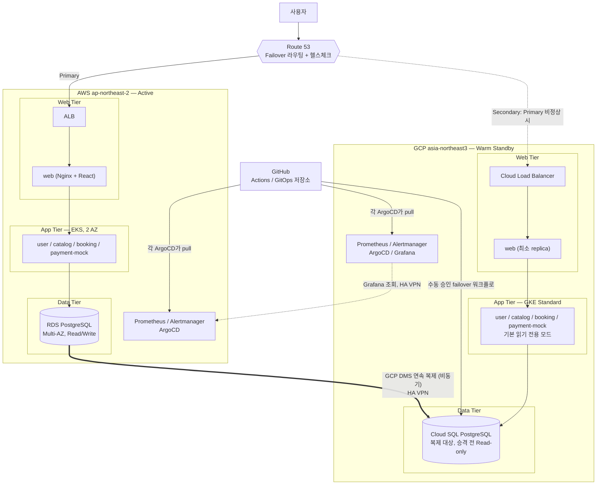
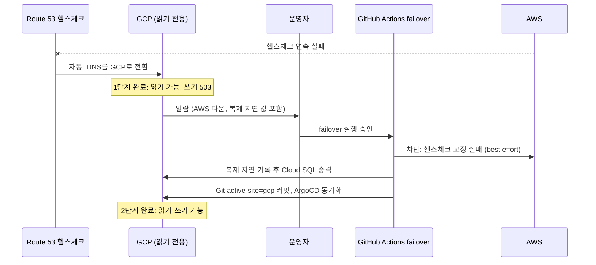

# 멀티클라우드 고가용성 아키텍처 제안 — Claude 안

> 작성 기준일: 2026-11-06. 가격·버전의 검증 상태는 [부록](#부록-사실-확인-현황)에 모아 두었습니다. 표시 없는 수치도 설계 목표이거나 추정치이며, 실측값이 아닙니다.

## 1. 한 줄 요약 / 설계 철학

**AWS 서울이 모든 사용자 트래픽을 처리하고, GCP 서울은 웜 스탠바이로 대기합니다. 장애가 나면 읽기는 자동으로 GCP로 넘어가고, 쓰기는 사람이 승인한 뒤에 엽니다.**

- **쓰기 지점은 언제나 하나입니다.** 멀티클라우드에서 가장 어렵고 위험한 문제는 양쪽 동시 쓰기입니다. 이 문제는 풀지 않고 구조적으로 피합니다.
- **자동화 범위를 위험도로 나눕니다.** 되돌리기 쉬운 DNS 전환은 자동으로, 되돌리기 어려운 DB 승격은 사람의 승인을 받아 진행합니다.
- **평상시 클라우드 간 호출을 두지 않습니다.** 클러스터 간 통신이 없으므로 서비스 메시나 멀티클러스터 네트워킹도 필요 없습니다. VPN은 DB 복제와 모니터링 조회에만 쓰며, VPN이 끊겨도 서비스는 멈추지 않습니다.
- **운영 도구가 한쪽 클라우드에 묶이지 않게 합니다.** AWS가 죽어도 GitHub, GCP의 ArgoCD, GCP의 Grafana, GCS의 Terraform state는 살아 있습니다.

## 2. 가정

사용자가 정하지 않은 항목에 대해 제가 세운 가정입니다. 하나라도 크게 다르면 13장과 12장을 다시 봐야 합니다.

| 항목 | 가정 |
|---|---|
| 팀 / 기간 | 4명, 8주 (인프라 경험은 부트캠프 수준) |
| 예산 | 프로젝트 전체 약 $1,000 이하 (크레딧 제외 기준) |
| 서비스 | **공연 티켓 예매** 예시. 읽기(공연 조회)와 쓰기(예매)가 뚜렷이 나뉘어 읽기 전용 모드를 보여 주기 좋습니다 |
| 트래픽 | 데모 수준, 부하 테스트 시 수백 RPS |
| 리전 | AWS `ap-northeast-2`, GCP `asia-northeast3` (둘 다 서울) |
| 도메인 | 팀이 도메인 1개를 보유하고 Route 53에서 관리 |
| 저장소 | GitHub Organization (공개 저장소 권장) |

서울-서울 구성은 지연이 낮아 복제에 유리하지만, 지역 단위 재해는 막지 못합니다. 과제의 초점이 클라우드 사업자 장애이므로 받아들입니다.

## 3. 전체 아키텍처



## 4. AWS/GCP 역할 분담과 이유

**선택: 액티브-스탠바이 (AWS Active, GCP Warm Standby, 읽기 전용으로 즉시 서비스 가능)**

| 대안 | 채택 여부 | 이유 |
|---|---|---|
| 액티브-액티브 | 제외 | 클라우드 간 동기 쓰기나 충돌 해결이 필요합니다. 부트캠프 범위를 넘고, 티켓 예매에서는 충돌이 곧 중복 판매입니다 |
| 서비스별 분담 (예: 분석은 BigQuery) | 제외 | 비용·기능 분담일 뿐이라 AWS 장애 시 서비스가 멈춥니다. 고가용성 목표를 채우지 못합니다 |
| 파일럿 라이트 (GCP 평소 꺼 둠) | 제외 | 비용은 낮지만 클러스터 기동까지 RTO가 길어지고, 평소 검증이 안 되어 정작 필요할 때 실패하기 쉽습니다 |
| **웜 스탠바이** | **채택** | 복잡도, 비용, 시연 효과의 균형이 가장 좋습니다 |

GCP도 평소에 일을 합니다. AWS 외부에서 합성 모니터링을 수행하고, Grafana를 호스팅하며, 복제 지연을 측정합니다.

## 5. 3Tier 상세

### Web
- React 정적 빌드를 Nginx 컨테이너로 양쪽 클러스터에 배포합니다.
- CloudFront + S3는 쓰지 않습니다. 정적 파일이 AWS에 묶이면 AWS 장애 시 화면도 사라지기 때문입니다.
- 인입은 각 클라우드 기본 컨트롤러를 씁니다. EKS는 AWS Load Balancer Controller, GKE는 GKE Ingress입니다. `ingress-nginx`는 유지보수 종료 공지가 있었으므로 쓰지 않습니다(미검증, 기억 기반).

### App (MSA)
서비스는 4개로 제한합니다. 시연 가치가 없는 서비스 추가는 일정만 소모합니다.

| 서비스 | 책임 | DB | GCP 읽기 전용 모드 동작 |
|---|---|---|---|
| `user` | 가입, 로그인, JWT 발급 | `user_db` | 로그인 가능, 가입 503 |
| `catalog` | 공연·좌석 조회 | `catalog_db` | 정상 동작 |
| `booking` | 좌석 예매 (`SELECT ... FOR UPDATE`) | `booking_db` | 503과 점검 안내 |
| `payment-mock` | 가짜 결제, 장애 주입 지점 | 없음 (상태 비저장) | 503 |

- 동기 HTTP(ClusterIP)만 씁니다. 세션은 상태 없는 JWT이므로 사이트 전환 후에도 재로그인이 필요 없습니다. 단, **서명 키는 양쪽이 같아야 합니다.**
- 사이트 모드(`readonly` / `readwrite`)는 Git이 관리하는 ConfigMap으로 주입하고, 앱이 마운트된 파일을 주기적으로 다시 읽습니다.
- 각 앱은 **항상 자기 사이트의 DB에만 연결**합니다. 전환 시 접속 주소를 바꿀 필요가 없습니다.

### Data
- RDS PostgreSQL 인스턴스 1개(Multi-AZ) 안에 서비스별 논리 DB를 둡니다. 서비스별 인스턴스 분리는 비용만 3배가 되므로 뺍니다.
- **복제: Google Database Migration Service(DMS) 연속 마이그레이션 작업.** 공식 문서상 logical decoding과 pglogical 기반이고, RDS에서는 `rds.logical_replication=1` 설정과 재부팅이 필요합니다.
- 수동 논리 복제 대신 DMS를 택한 이유는 복제 대상이 승격 전까지 읽기 전용이라 실수로 인한 쓰기를 막아 주고, 승격 절차가 이미 정의되어 있기 때문입니다. 2주차 PoC에서 실패하면 네이티브 논리 복제로 대체합니다.
- Redis, Kafka는 쓰지 않습니다. 14장에 이유를 적었습니다.

### 동기화의 한계 (발표에서 먼저 말할 것)
1. **비동기 복제이므로 RPO는 0이 아닙니다.** 장애 직전 커밋은 유실될 수 있습니다.
2. **DDL은 자동 복제되지 않습니다.** 대응으로 데모 2주 전 스키마를 동결하고, 이후 변경이 생기면 DMS 작업을 다시 초기화합니다.
3. **PK 없는 테이블은 변경분 복제가 제한됩니다.** 전 테이블에 UUID PK를 강제하면 시퀀스 동기화 문제도 함께 피할 수 있습니다.
4. **잘못된 `DELETE`도 그대로 복제됩니다.** 복제는 백업이 아닙니다. 복구는 RDS PITR로 합니다.
5. **DMS 작업은 승격하면 끝납니다.** 역방향 복제가 자동으로 생기지 않으므로 복귀(failback)는 별도 절차입니다.
6. **복제 슬롯이 멈추면 RDS에 WAL이 쌓여 저장소를 채울 수 있습니다.** 슬롯 지연 알람을 필수로 둡니다.

## 6. 고가용성 / 장애 조치

아래 RTO/RPO는 **설계 목표**입니다. 7~8주차에 실측해 발표 자료의 값으로 교체합니다.

| 시나리오 | 자동 동작 | 사람의 조치 | RTO 목표 | RPO 목표 |
|---|---|---|---|---|
| 파드 / 노드 장애 | 재스케줄, ALB 대상 제외 | 없음 | 1분 이내 | 0 |
| AZ 장애 | 2 AZ 분산(topology spread, PDB), RDS Multi-AZ 전환 | 없음 | 3분 이내 | 0 |
| RDS 주 인스턴스 장애 | Multi-AZ 자동 전환 | 없음 | 3분 이내 | 0 |
| **AWS 리전 / 클라우드 전체 장애** | Route 53이 GCP로 전환, **읽기 전용 서비스** | failover 승인 후 쓰기 개방 | 읽기 3분, 쓰기 15분 | 1분 이내 (보장 아님, 복제 지연에 좌우) |
| 데이터 손상 (잘못된 쿼리) | 없음 | RDS PITR 복원 후 DMS 재초기화 | 1시간 | 5분 내외 |
| 잘못된 배포 | Argo Rollouts 분석 실패 시 자동 중단·롤백 | 원인 수정 후 Git revert | 5분 이내 | 0 |
| VPN 단절 | 서비스 영향 없음, 지연 알람 | 터널 복구 | 해당 없음 | 복구 전까지 스탠바이 데이터가 뒤처짐 |

### 페일오버 트리거: 2단계 방식



- **1단계(자동):** 헬스체크는 10초 간격, 3회 실패 기준입니다. AWS가 스스로 복구되면 DNS도 자동으로 돌아오고, 데이터 영향은 없습니다. 짧은 장애나 오탐에도 안전합니다.
- **2단계(승인):** 오탐으로 승격하면 양쪽이 모두 쓰기 가능한 **스플릿 브레인**이 됩니다. 티켓 중복 판매로 이어지므로 자동화하지 않습니다.

### 핵심 함정: AWS 복구 시 자동 복귀 차단
승격 후 AWS가 살아나면 Route 53은 Primary가 정상이라 판단해 **낡은 RDS 쪽으로 트래픽을 되돌립니다.** 두 겹으로 막습니다.
1. failover 워크플로가 헬스체크 경로를 항상 실패하는 경로로 변경합니다. Route 53 제어 평면 의존이라 AWS 전면 장애 시 실패할 수 있습니다.
2. GitHub의 `active-site=gcp` 값을 AWS의 ArgoCD가 복구 후 동기화해 AWS 앱을 읽기 전용으로 전환하고, `/healthz/site`를 실패시킵니다.

2번이 적용되기 전 짧은 틈은 남습니다(14장).

### 복귀(failback)
자동화하지 않는 계획 작업입니다. 점검 창을 열고 `pg_dump`/복원으로 Cloud SQL 데이터를 RDS로 옮긴 뒤, DMS를 재구성하고 헬스체크를 복원합니다. 데모에서는 Terraform으로 환경을 재구성해 대신합니다.

## 7. 클라우드 간 네트워크 / 트래픽 라우팅

### 사설 연결: HA VPN + AWS Site-to-Site VPN (BGP)
- 구성: GCP HA VPN 게이트웨이 1개 ↔ AWS VPN 연결 2개, **총 4터널**. Google 문서상 AWS 피어에서 99.99% 가용성을 얻는 구성입니다. 개발 기간에는 2터널로 비용을 줄입니다.
- CIDR은 처음부터 겹치지 않게 고정합니다: AWS VPC `10.10.0.0/16`, GCP 노드 `10.20.0.0/20`, 파드 `10.21.0.0/16`, 서비스 `10.22.0.0/20`, Cloud SQL 사설 대역 `10.23.0.0/20`.
- **주의:** Cloud SQL은 피어링된 Google 관리 VPC에 있어서, 피어링 커스텀 경로 내보내기와 Cloud Router의 사용자 지정 경로 광고가 필요할 가능성이 높습니다(미검증, 2주차 PoC 최우선 확인 항목).

**AWS Interconnect - multicloud를 택하지 않은 이유:** 2026-04 GA로 VPN보다 성능이 좋고 무료 구간 소개도 있지만, 지원 5개 리전에 서울이 포함되는지 확인하지 못했습니다. 이 프로젝트의 복제 트래픽에는 VPN으로 충분합니다. 서울 지원과 Terraform 자동화가 확인되면 발표의 "개선 방향"으로 언급할 수 있습니다.

### 사용자 트래픽: Route 53 Failover
| 레코드 | 대상 | 비고 |
|---|---|---|
| `app.example.com` PRIMARY | ALB alias | 헬스체크 연결 (`/healthz/site`) |
| `app.example.com` SECONDARY | GCP LB 고정 IP (A, TTL 30초) | 헬스체크 없음, 항상 대기 |

- 가중치 기반이나 지연 기반 대신 Failover 정책을 씁니다. 평소 GCP로 사용자 트래픽이 가면 안 되기 때문입니다.
- 헬스체크는 단순 생존이 아니라 앱-DB 연결까지 확인합니다. 단, 사소한 의존성 실패로 전환되지 않도록 `booking` DB 연결과 Web 응답만 포함합니다.
- Cloudflare 같은 외부 GSLB는 AWS 의존을 더 줄이지만, 사업자가 하나 늘고 AWS 중심 요구에서 벗어나므로 뺍니다. DNS의 AWS 의존은 14장에 적어 두었습니다.

## 8. Terraform / Ansible

### 역할 경계

| 도구 | 담당 | 예시 |
|---|---|---|
| **Terraform** | 클라우드 리소스 생성 (만들고 유지) | VPC, EKS, GKE, RDS, Cloud SQL, VPN, Route 53, IAM |
| **Ansible** | 순서가 있는 1회성 절차 (실행하고 끝) | ArgoCD 부트스트랩, DB 사전 설정, `failover.yml`, `failback.yml` |
| **ArgoCD** | 클러스터 내부의 지속 상태 | 앱, 모니터링 스택, External Secrets |

관리형 쿠버네티스라 노드 OS를 Ansible로 관리할 일이 거의 없습니다. 억지로 노드 구성 도구로 쓰지 않고 **운영 절차 자동화**에 집중시키는 것이 이 안의 판단입니다. Terraform에는 Kubernetes/Helm provider를 쓰지 않아 클러스터 삭제 시 꼬이는 문제를 피합니다.

### 저장소·모듈 구조
```text
infra/
├── terraform/
│   ├── modules/            # 공식 커뮤니티 모듈(버전 고정)을 감싼 얇은 래퍼
│   └── stacks/
│       ├── aws-network/  aws-eks/  aws-data/  aws-dns/
│       ├── gcp-network/  gcp-gke/  gcp-data/
│       └── cross-vpn/      # 양쪽 provider 사용, 마지막에 적용
└── ansible/
    ├── inventory/          # 동적 인벤토리 없음. 점프 VM 2대와 localhost
    └── playbooks/          # bootstrap-argocd, db-prepare, failover, failback
```

### State 관리
- **클라우드별로 분리합니다.** AWS 스택은 S3(`use_lockfile = true`), GCP 스택과 `cross-vpn`은 GCS에 둡니다. AWS 장애 중에도 GCP 쪽 Terraform을 실행할 수 있어야 하기 때문입니다.
- DynamoDB 잠금은 공식 문서상 deprecated이므로 쓰지 않습니다.
- 스택을 나눠 `aws-network`와 `gcp-network`, 상태 버킷, 도메인 영역은 야간 삭제 대상에서 제외합니다. 스택 간 값은 `terraform_remote_state`로 읽습니다.
- PR에서 `plan`, main 병합 후 수동 승인으로 `apply`를 실행합니다.

## 9. CI/CD

### CI 추천: GitHub Actions
- **어느 클라우드에도 올라가지 않습니다.** 자체 호스팅 Jenkins는 어딘가의 클러스터에 올려야 해서 그 클라우드가 죽으면 failover 도구도 같이 죽습니다.
- **OIDC로 AWS와 GCP 모두 장기 키 없이 인증**할 수 있습니다.
- **Environment 승인 기능**이 failover 2단계의 사람 승인 수단을 겸합니다.
- 코드 저장소와 함께 있어 별도 운영 부담이 없습니다. 공개 저장소의 표준 러너는 무료입니다.

### CI 파이프라인
```text
PR:    단위 테스트 → 린트 → 이미지 빌드 → Trivy 스캔
main:  이미지 빌드 → Trivy(HIGH/CRITICAL 차단) → ECR + Artifact Registry 동시 푸시
       → gitops 저장소에 digest 갱신 PR (overlays/aws)
       → AWS Healthy 확인 후 후속 PR (overlays/gcp)
```
이미지를 **양쪽 레지스트리에 모두 푸시**합니다. GKE가 ECR에 의존하면 AWS 장애 시 스탠바이 파드가 이미지를 받지 못합니다.

### ArgoCD: 클러스터마다 독립 인스턴스
| 토폴로지 | 판단 |
|---|---|
| 허브-스포크 (EKS에 허브) | AWS 장애 시 GCP 배포 수단도 사라짐 |
| 허브-스포크 (GKE에 허브) | 스탠바이가 운영의 핵심이 되고, AWS 클러스터 자격증명을 다른 클라우드에 보관해야 함 |
| **클러스터별 독립 ArgoCD** | **채택.** 장애 도메인 분리, 클러스터 간 자격증명 불필요. 단점은 UI가 2개 |

ApplicationSet의 Cluster generator 같은 멀티 클러스터 기능은 필요 없습니다. 각 인스턴스의 App-of-Apps가 자기 사이트 경로만 바라봅니다. 버전은 3.5 계열을 권장합니다(3.2 계열은 EOL로 보고됨).

### GitOps 저장소 구조
```text
gitops/
├── bootstrap/{aws,gcp}/root-app.yaml
├── platform/               # kube-prometheus-stack, external-secrets, argo-rollouts, ...
│   ├── base/  overlays/{aws,gcp}/
├── apps/{web,user,catalog,booking,payment-mock}/
│   ├── base/  overlays/{aws,gcp}/    # Ingress, replica, DB secret 경로가 다름
└── site-state/active-site.yaml       # failover 시 변경되는 단일 값
```
저장소는 `app`, `gitops`, `infra` 3개입니다. Kustomize를 쓰고, 외부 차트만 Helm을 사용합니다.

### 배포 전략
- **AWS `booking`, `catalog`:** Argo Rollouts 캐너리. 트래픽 라우터 없이 **replica 비율 기반**(4개 중 1개 → 분석 → 전체)으로 단순화합니다. Prometheus AnalysisTemplate으로 5xx 비율이 기준을 넘으면 자동 롤백합니다.
- **나머지와 GCP:** 롤링 업데이트. GCP는 AWS 검증 후에 반영되므로 나쁜 배포가 양쪽에 동시에 퍼지지 않습니다.
- Rollouts CRD는 Server-Side Apply로 설치합니다(v1.10 계열 CRD 크기 문제에 대한 사용자 보고가 있으며 미검증).
- 스키마 변경은 expand-contract 방식으로만 합니다. 양쪽 앱 버전이 잠시 달라질 수 있기 때문입니다.

## 10. 모니터링 / 관측성

### 스택
| 영역 | 도구 | 비고 |
|---|---|---|
| 메트릭 | `kube-prometheus-stack` (클러스터별) | Prometheus 3.13 LTS 계열 권장, 보존 7일 |
| DB | `postgres_exporter`, CloudWatch 알람 일부 | 복제 슬롯 지연 수집 |
| 대시보드 | Grafana **1개 (GKE)** | AWS가 죽어도 살아 있어야 하므로 GCP에 배치 |
| 외부 감시 | `blackbox_exporter` (GCP에서 AWS 공개 URL 프로브) | Route 53 헬스체크와 별개 경로 |
| 로그 (선택, 6주차 이후) | Loki + Alloy (클러스터별) | 일정이 밀리면 가장 먼저 제외 |

### 멀티 클러스터 수집 구조: 중앙 수집 없이 조회 시 통합
Prometheus를 클러스터별로 독립 운영하고, GKE의 Grafana가 두 Prometheus를 데이터 소스로 조회합니다(AWS 쪽은 VPN을 통한 내부 LB). 모든 메트릭에 `site` 외부 라벨을 붙입니다.

Thanos, Mimir는 뺍니다. 장기 보존과 전역 쿼리가 강점인데 8주 프로젝트에 장기 보존이 필요 없습니다. 중앙 수집 저장소를 AWS에 두면 정작 장애 때 쓸 수 없다는 점도 있습니다. AWS 장애 시 AWS 패널이 비는 것은 결함이 아니라 그 자체로 장애 신호입니다.

### 복제 지연의 직접 측정
`heartbeat` 테이블에 RDS 쪽 CronJob/앱이 10초마다 현재 시각을 기록하고, GCP 쪽 exporter가 Cloud SQL에서 읽어 차이를 계산합니다. 슬롯 바이트 지연과 달리 **"지금 failover하면 몇 초를 잃는가"** 를 바로 보여 주는 값이며, 승인자의 판단 근거이자 시연의 핵심 패널입니다.

### 대시보드
1. **Failover 상황판:** 활성 사이트, DNS 응답, 사이트별 RPS, 복제 지연, 사이트 모드
2. **서비스 RED:** 서비스별 요청률, 오류율, 지연
3. **클러스터:** 노드, 파드 재시작, 리소스 사용률
4. **배포:** Rollouts 상태, ArgoCD 동기화 상태

### SLO와 알람
| SLO | 목표 (30일) |
|---|---|
| 조회 API 가용성 | 99.5% |
| 예매 API 가용성 | 99.0% (failover 승인 시간 포함) |
| 예매 p95 지연 | 500ms 미만 |
| 복제 지연 | 99% 시간 동안 60초 미만 |

| 알람 | 조건 | 심각도 |
|---|---|---|
| AWS 사이트 다운 | blackbox 실패 2분 지속 | Critical → failover 판단 시작 |
| 복제 지연 | 60초 초과 5분 지속 | Warning |
| 복제 슬롯 WAL 누적 | 5GB 초과 | Critical (RDS 저장소 고갈 위험) |
| VPN 터널 다운 | BGP 세션 전체 단절 2분 지속 | Warning |
| 오류 예산 소진 | 1시간 burn rate 14.4 초과 | Critical |
| 크래시 루프 | 재시작 반복 5분 지속 | Warning |

Alertmanager는 양쪽에서 Slack으로 보냅니다. 메시지에 `site`를 포함합니다. 중복 알림은 데모 규모에서 받아들입니다.

## 11. 보안

| 영역 | 결정 |
|---|---|
| CI 인증 | GitHub OIDC → AWS IAM Role, GCP Workload Identity Federation. 장기 키 저장 금지 |
| 파드 권한 | EKS Pod Identity, GKE Workload Identity. 서비스별 최소 권한 |
| 사람 권한 | 팀원별 IAM 사용자 대신 AWS IAM Identity Center와 Google 계정, MFA 필수 |
| 시크릿 | External Secrets Operator + AWS Secrets Manager / GCP Secret Manager. Git에는 참조만 저장 |
| 시크릿 동기화 | DB 비밀번호는 사이트별로 다르게, **JWT 서명 키만 양쪽 동일**(양쪽 저장소에 Terraform으로 주입) |
| 네트워크 | DB, 노드 모두 사설 서브넷. DB 보안그룹은 앱 서브넷과 VPN 대역에서 5432만 허용 |
| 파드 간 | NetworkPolicy 기본 차단 후 필요한 경로만 허용 (EKS VPC CNI 네트워크 정책, GKE Dataplane V2) |
| 클러스터 API | 허용 IP로 제한. CI는 클러스터에 직접 접근하지 않음 (GitOps pull의 이점) |
| 전송 구간 | 공개 구간 TLS (ACM, Google 관리형 인증서), 복제는 IPsec + PostgreSQL TLS |
| 저장 구간 | RDS, Cloud SQL, 상태 버킷 암호화와 버전 관리 |
| 이미지 | Trivy 차단, 레지스트리 스캔, digest 고정 배포, 비 root 실행 |
| IaC | PR에서 `tfsec` 또는 `checkov` 실행 |
| 비용 보안 | 양쪽 예산 알림 설정 (키 유출 시 비용 폭주도 탐지) |

mTLS와 이미지 서명은 뺍니다(14장).

## 12. 예상 비용

> **전부 추정치입니다.** 공식 확인 단가는 부록에 표시했고, 서울 리전 단가 대부분은 미검증입니다. 시작 전에 AWS, GCP 가격 계산기로 재계산하세요. USD 기준, 730시간, 세금과 크레딧 제외.

### 24시간 상시 운영 시 월 비용

| 클라우드 | 항목 | 사양 | 월 추정 |
|---|---|---|---|
| AWS | EKS 제어 평면 | $0.10/h | $73 |
| | 워커 노드 | t3.medium × 4 | $152 |
| | ALB | 1개 + 소량 LCU | $25 |
| | NAT Gateway | 2개 + 소량 데이터 | $91 |
| | RDS PostgreSQL | db.t4g.medium Multi-AZ, 50GB | $145 |
| | Site-to-Site VPN | 연결 2개 | $73 |
| | Route 53 | 영역 1개, 빠른 간격 헬스체크 | $4 |
| | 스토리지, 공인 IPv4, 기타 | EBS, ECR, Secrets 등 | $42 |
| | **AWS 소계** | | **$605** |
| GCP | GKE 관리비 | $73에서 무료 크레딧 $74.40 상쇄 | $0 |
| | 워커 노드 | e2-standard-2 × 2 + 디스크 | $135 |
| | Cloud SQL | 2 vCPU/8GB 단일 존, 50GB | $141 |
| | Cloud Load Balancer | 소량 트래픽 | $20 |
| | HA VPN | 4터널 ($0.05~0.075/h) | $180 |
| | Cloud NAT, 레지스트리, 기타 | | $50 |
| | **GCP 소계** | | **$526** |
| | **합계** | | **약 $1,130/월** |

### 실제 사용 패턴별 비용

| 패턴 | 추정 |
|---|---|
| 평일 10시간만 운영 (월 220시간) + 상시 소액 | **약 $360/월** |
| 8주 프로젝트 전체 (아래 단계별 사용 + 여유 30%) | **약 $750~1,000** |

| 기간 | 구성 | 사용 시간 | 추정 |
|---|---|---|---|
| 1~2주 | AWS 단독, 단일 AZ DB, NAT 1개 | 주 50h | $60 |
| 3~6주 | 양쪽 구성, VPN 2터널, Multi-AZ 끔 | 주 50h | $265 |
| 7주 | 전체 구성 | 80h | $125 |
| 8주 | 데모 주간 상시 운영 | 168h | $260 |

### 비용 절감 방법
1. **퇴근 시 `terraform destroy`를 기본으로 합니다.** 네트워크 외 스택을 GitHub Actions 예약 작업으로 삭제합니다. 재구성 시간이 곧 복구 연습이 됩니다.
2. DMS 복제와 VPN은 5주차 이후에만 켭니다. 가장 비싼 항목이면서 앱 개발에는 필요 없습니다.
3. 개발 중에는 Multi-AZ를 끄고, NAT와 VPN을 최소 구성으로 둡니다.
4. 개발용 워커 노드는 Spot을 씁니다. 데모 주간에는 일반 인스턴스로 돌립니다.
5. 신규 가입 크레딧을 먼저 확인합니다. 조건과 금액은 시점에 따라 다릅니다(미검증).
6. 양쪽에 $100, $300, $500 예산 알림을 설정합니다. 삭제 누락이 가장 큰 비용 사고 원인입니다.

## 13. 구현 로드맵

**역할:** A = AWS/Terraform, B = GCP/네트워크/DB, C = CI/CD/GitOps, D = 앱/모니터링. 페일오버 절차는 전원이 한 번씩 직접 실행합니다.

| 주차 | 목표 | A | B | C | D | 완료 기준 |
|---|---|---|---|---|---|---|
| 1 | 기반 | AWS 네트워크, state 버킷 | GCP 네트워크, CIDR 확정 | 저장소, CI 기본 | 앱 API 설계, 스키마 | `terraform plan` 통과 |
| 2 | **위험 먼저 제거** | RDS 논리 복제 설정 | **VPN + DMS PoC** | 이미지 빌드, 양쪽 푸시 | `catalog`, `user` | RDS 변경이 Cloud SQL에 보임 |
| 3 | AWS 3Tier | EKS, RDS 스택 | GKE 스택 | ArgoCD 부트스트랩 | `booking`, `payment-mock`, Web | AWS에서 예매 성공 |
| 4 | GCP 복제 | Route 53 스택 | GKE 앱 오버레이 | GitOps 오버레이 완성 | 읽기 전용 모드 구현 | GCP 주소로 조회 성공 |
| 5 | 관측성 | 알람 지원 | 복제 지연 수집 | Rollouts 분석 | Prometheus, Grafana, SLO | 상황판 완성 |
| 6 | 장애 조치 | 헬스체크 튜닝 | `failover.yml` | 승인 워크플로 | 부하 스크립트(k6) | 첫 failover 성공, 스키마 동결 |
| 7 | 강화 | AZ 장애 실험 | 4터널, 재구성 절차 | 나쁜 배포 실험 | 보안 점검, 로그(선택) | RTO/RPO 실측 3회 |
| 8 | 발표 | 비용 정리 | 런북 정리 | 데모 자동화 | 자료, 녹화 | 리허설 3회, 백업 영상 |

**범위 축소 순서(일정이 밀릴 때):** 로그 → Rollouts(롤링 + Git revert로 대체) → 4터널(2터널 유지) → DMS(네이티브 논리 복제나 `pg_dump` 대체). 읽기 전용 모드와 상황판은 끝까지 지킵니다.

## 14. 리스크와 이 안의 약점

### 약점 (솔직하게)
| 약점 | 영향 | 대응 / 수용 이유 |
|---|---|---|
| **DNS가 AWS에 의존** | Route 53이 전면 불능이면 전환 불가 | Route 53 데이터 평면의 높은 가용성에 기대어 수용(미검증, 기억 기반). "AWS 전체 장애"를 완전히 막지는 못하며, 발표 때 명시 |
| **쓰기 복구가 사람에 의존** | 새벽 장애 시 쓰기 RTO 증가 | 의도된 선택. 데이터 정합성을 쓰기 가용성보다 우선 |
| **RPO > 0** | 장애 직전 예매 유실 가능 | 비동기 복제의 근본 한계. 실서비스라면 결제 내역과 대사 필요 |
| **DMS의 비목적 사용** | 마이그레이션 도구를 DR 복제에 장기 사용. 장시간 안정성 미확인 | 데모 기간(수 주)에는 충분할 것으로 판단. 실서비스 권고안은 아님 |
| **DNS 캐시** | 일부 클라이언트는 TTL을 무시해 전환이 늦음 | 데모는 TTL 준수 클라이언트로 측정, 한계를 명시 |
| **GKE 제어 평면이 단일 존** | 스탠바이 쪽 존 장애와 겹치면 대응 불가 | 이중 장애로 판단, 무료 크레딧 적용을 위해 수용 |
| **복구 후 차단 틈** | AWS 복구 직후 ArgoCD 동기화 전 낡은 RDS 쓰기 가능 | 헬스체크 고정이 성공하면 트래픽이 가지 않음. 둘 다 실패하는 전면 장애 시나리오에서는 잔여 위험 |
| **양쪽 구현 차이** | Ingress, 시크릿, IAM이 달라 "똑같은 환경"이 아님 | 차이를 오버레이에 격리 |
| **스탠바이 용량 부족** | 전환 직후 HPA 증설까지 지연 증가 | 최대 4노드까지 오토스케일, 데모 전 사전 증설 가능 |
| **기간 위험** | VPN + DMS + Cloud SQL 사설 연결이 예상보다 오래 걸릴 수 있음 | 2주차로 앞당겨 조기에 검증 |

### 일부러 뺀 것
| 제외 | 이유 |
|---|---|
| 액티브-액티브, CockroachDB 등 분산 DB | 일정 내 운영 불가, 비용 큼 |
| 서비스 메시 (Istio 등) | 클러스터 간 호출이 없어 효용이 작고 학습 비용이 큼 |
| Kafka, 비동기 이벤트 | 멀티클라우드 복제 문제가 하나 더 늘어남 |
| Redis | 좌석 잠금은 PostgreSQL 행 잠금으로 충분. 필요 시 성능 개선 단계에서 추가 |
| Thanos, Mimir | 10장 참조 |
| 분산 추적 | 서비스 4개에서는 로그와 메트릭으로 충분 |
| 별도 스테이징 클러스터 | 비용. 스테이징은 EKS 네임스페이스로 대체 |
| Kyverno, 이미지 서명, mTLS | 가치는 있지만 고가용성 시연의 핵심이 아님. 시간이 남으면 추가 |
| Karpenter | 고정 노드 그룹과 기본 오토스케일로 충분 |

## 15. 발표/시연 포인트

**핵심 메시지:** "멀티클라우드라서 무조건 자동으로 넘어간다"가 아니라, **"무엇을 자동화하고 무엇을 자동화하지 않을지 근거를 가지고 결정했다"** 입니다.

### 메인 데모: AWS 전체 장애 (약 7분)
화면은 Failover 상황판, 사용자 웹, k6 부하, GitHub Actions 4개를 띄워 둡니다. GKE의 Grafana는 AWS와 무관하게 계속 보입니다.

| 순서 | 동작 | 관객에게 보이는 것 |
|---|---|---|
| 1 | 평상시 예매 실행 | RPS는 AWS에만, 복제 지연은 수 초 |
| 2 | `chaos/aws-down.sh` 실행 (ALB 보안그룹 인바운드 제거, AWS 앱 replica 0) | 오류율 급증, AWS 패널 비어 감 |
| 3 | 약 1~2분 대기 | Route 53이 GCP로 자동 전환, **공연 조회 복구** |
| 4 | 예매 시도 | **"점검 중" 503.** 의도된 동작임을 설명 |
| 5 | Slack 알람과 복제 지연 값 확인 후 failover 승인 | GitHub 승인 화면 |
| 6 | Cloud SQL 승격, Git 커밋, ArgoCD 동기화 | **예매 복구**, 활성 사이트 GCP |
| 7 | 전환 직전 커밋과 비교 | **실측 RTO와 RPO 공개** |

실제 리전을 끌 수는 없으므로 **시뮬레이션임을 명시**합니다. RDS는 살아 있어도 앱을 먼저 멈춰 쓰기가 끊긴 시점을 측정합니다.

### 짧은 보조 데모 (각 1~2분)
- **AZ 장애:** 한 AZ의 노드 제거 + RDS 강제 failover(재부팅) → 트래픽 유지
- **나쁜 배포:** 5xx를 내는 버전을 커밋 → 캐너리 분석 실패, 자동 롤백, GCP에는 반영 안 됨
- **스플릿 브레인 방지:** AWS 복구 후에도 트래픽이 돌아오지 않고 앱이 읽기 전용임을 확인

### 평가자 질문 대비
- *왜 쓰기는 자동으로 넘기지 않았나요?* → 오탐 한 번이 중복 판매로 이어지므로, 15분의 쓰기 RTO를 택했습니다.
- *Route 53이 죽으면요?* → 막지 못합니다. 약점이며, 외부 DNS 이중화가 다음 단계입니다.
- *왜 멀티클라우드인가요?* → 이 규모만 보면 단일 클라우드 멀티리전이 더 합리적입니다. 이 프로젝트는 사업자 장애에 대비하는 설계의 비용과 한계를 직접 측정해 보는 학습 과제입니다.

### 사고 대비
데모 전날 전체 재구성과 DMS 재동기화를 끝내고(초기화 시간 고려), 성공 녹화본을 준비합니다. 라이브 실패 시 녹화로 전환합니다.

## 부록: 사실 확인 현황

### 확인한 항목
| 항목 | 내용 | 출처 수준 |
|---|---|---|
| EKS 요금 | 표준 $0.10/h, 연장 지원 $0.60/h | [AWS 블로그](https://aws.amazon.com/blogs/containers/amazon-eks-extended-support-for-kubernetes-versions-pricing) |
| GKE 요금 | $0.10/h, 결제 계정당 월 $74.40 크레딧 (zonal/Autopilot 적용) | [Google 가격](https://cloud.google.com/kubernetes-engine/pricing) 발췌 일부 |
| AWS VPN | $0.05/h (**오하이오 예시, 서울 미검증**) | [AWS](https://aws.amazon.com/vpn/pricing/) |
| GCP HA VPN | 터널 $0.05/h 표기, 도쿄 예시 $0.075. AWS 피어 99.99%는 4터널 (**서울 단가 미검증**) | [Google](https://cloud.google.com/vpn/pricing) |
| DMS 방식 | PostgreSQL 연속 마이그레이션은 logical decoding + pglogical | [Google](https://docs.cloud.google.com/database-migration/docs/postgres/scenario-overview) |
| RDS 논리 복제 | `rds.logical_replication=1`, 정적 파라미터, 재부팅 필요 | [AWS](https://docs.aws.amazon.com/AmazonRDS/latest/UserGuide/PostgreSQL.Concepts.General.FeatureSupport.LogicalReplication.html) |
| Terraform S3 | `use_lockfile` 지원, DynamoDB 인자 deprecated | [HashiCorp](https://developer.hashicorp.com/terraform/language/backend/s3) |
| AWS Interconnect | 2026-04 GA, Google Cloud 우선 지원, 5개 리전 | [AWS](https://aws.amazon.com/about-aws/whats-new/2026/04/aws-announces-ga-AWS-interconnect-multicloud/) |
| Argo Rollouts | 최신 v1.10.2로 표시, Prometheus 분석 지원 | [GitHub](https://github.com/argoproj/argo-rollouts/releases), [문서](https://argo-rollouts.readthedocs.io/en/stable/features/analysis/) |
| Self-hosted 러너 과금 | 2026-03 예정분 연기 공지 (이후 변동은 미검증, 이 안은 GitHub 호스티드 러너 사용) | [GitHub](https://github.blog/changelog/2025-12-16-coming-soon-simpler-pricing-and-a-better-experience-for-github-actions/) |

### 2차 출처만 확인 (공식 재확인 필요)
- Argo CD 최신 안정판 3.5.x, 3.2 계열 EOL ([endoflife.date](https://endoflife.date/argo-cd))
- Prometheus 3.13 LTS, 최신 3.15.x ([endoflife.date](https://endoflife.date/prometheus))
- EKS 1.36 제공, 1.34 표준 지원 2026-12-02 종료 ([cloudmagazin](https://www.cloudmagazin.com/en/2026/09/22/kubernetes-support-ends-amazon-charges-six-times-the-price/), [ecorpit](https://ecorpit.com/eks-1-33-standard-support-ends-upgrade-path-cost-2026/)). 양쪽 클라우드에 공통으로 제공되는 최신 마이너를 시작 시 확인해 선택합니다.
- Route 53 헬스체크 $0.50 또는 $0.75 + 옵션 요금 (출처 간 차이)

### 미검증
- **서울 리전 단가 전반:** EC2, RDS, NAT Gateway, ALB, GCE, Cloud SQL, GCLB, Cloud NAT, 12장 금액 전체
- **DMS 동작:** 승격 소요 시간, 비용, DDL/시퀀스 처리 세부, 장기 복제 안정성, Cloud SQL 사설 경로와 VPN 조합
- **AWS Interconnect:** 서울 지원 여부, 무료 구간 조건
- **GKE:** Regular 채널의 현재 버전
- **기억 기반 내용:** `ingress-nginx` 유지보수 종료, Route 53 데이터 평면 가용성 특성, alias TTL, 공개 저장소 Actions 무료 조건, 클라우드 신규 크레딧
- **실측 필요:** 이 문서의 모든 RTO/RPO
