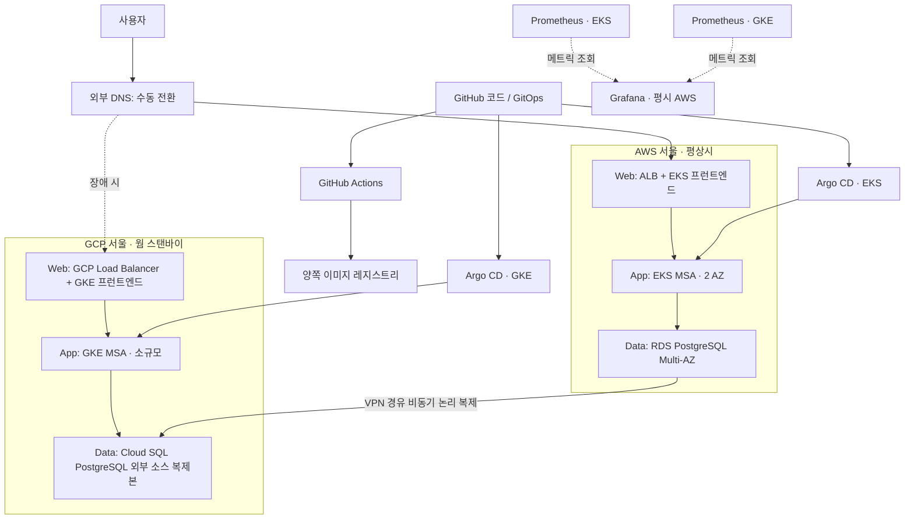

# 1. 한 줄 요약 / 설계 철학

AWS 2개 AZ에서 평상시 서비스를 운영하고 GCP에 작은 웜 스탠바이를 두며, 데이터 복제와 **사람이 승인하는 단일 쓰기 전환**으로 복구 과정을 시연한다. 자동화보다 복구 절차와 데이터 손실 범위를 설명할 수 있는 구성이 목표다.

# 2. 가정 (팀 규모, 기간, 예산, 서비스 예시 등 — 사용자 미정 사항에 대해 직접 세운 가정을 명시)

- 4명, 6주, 상시 운영 기준 월 600~800달러의 실습 예산과 별도 클라우드 크레딧을 가정한다. 세금·환율은 제외한다.
- 소규모 예약 서비스: 조회와 예약 생성, 사용자는 데모 계정으로 로그인한다. 실결제와 개인정보는 다루지 않는다.
- AWS 서울 `ap-northeast-2`가 주, GCP 서울 `asia-northeast3`가 복구 대상이다. 사용량은 낮고 단일 리전 전체 장애가 주요 데모 대상이다.
- 아래 수치는 설계 목표이지 측정된 SLA가 아니다. 리전별 가용성, 할당량, 호환 버전과 실제 단가는 구현 전 검증한다.

# 3. 전체 아키텍처 (Mermaid 다이어그램 필수, 3Tier 각 계층이 어디에 있는지 드러나야 함)



# 4. AWS/GCP 역할 분담과 그 이유 (액티브-스탠바이, 액티브-액티브, 서비스별 분담 등 무엇을 택했고 왜 그런지)

AWS 액티브 / GCP 웜 스탠바이. 평소 모든 사용자 쓰기는 AWS만 받는다. GCP에는 같은 이미지와 애플리케이션을 최소 복제 수로 실행하되 외부 사용자 트래픽은 보내지 않는다. 다중 쓰기 충돌과 분산 트랜잭션을 피하면서 클라우드 장애 시 전환을 실습한다. GCP 단일 존 GKE와 단일 Cloud SQL 복제본은 **DR 사이트 자체의 존 고가용성을 보장하지 않는다**.

# 5. 3Tier 상세: Web / App(MSA 서비스 분할 예시 포함) / Data 계층, 멀티클라우드 데이터 동기화 방법과 한계

- **Web**: 각 클라우드의 관리형 L7 로드밸런서가 Kubernetes 프런트엔드와 `/api` 요청을 전달한다. TLS 종료, 정적 화면과 API 라우팅을 담당한다.
- **App**: `catalog`(예약 가능 항목), `booking`(예약 생성·조회), `identity`(데모 인증) 세 서비스로 나눈다. 각 서비스는 독립 이미지와 배포를 갖고 DB 내 별도 스키마를 소유한다. 예약의 중복 방지는 DB 유니크 제약으로 처리한다. AWS는 서비스별 최소 2개 Pod를 AZ에 분산하고 GCP는 최소 1개로 대기한다.
- **Data**: AWS RDS PostgreSQL Multi-AZ DB 인스턴스 한 개가 주 DB이며 GCP Cloud SQL for PostgreSQL 외부 기본 인스턴스 복제본을 비동기로 유지한다. [Cloud SQL 공식 절차](https://docs.cloud.google.com/sql/docs/postgres/replication/configure-replication-from-external)는 RDS를 외부 소스로 명시한다. VPN 경로, 사설 서비스 접근 범위 및 라우팅, 양쪽 버전·권한을 실습 초기에 검증한다. 초기 데이터 적재와 논리 복제 슬롯, 지연 및 WAL 증가를 감시한다.

복제는 커밋 지연이 있고 장애 순간 미전달 데이터는 손실될 수 있다. 스키마 변경은 양쪽에 호환되도록 먼저 적용하고, 시퀀스 값과 권한 등 논리 복제에 포함되지 않는 항목은 전환 절차에서 확인·보정한다. 복제본 승격 후 역방향 자동 복제는 없다. 백업을 별도로 보관하고 복구를 시험한다. 실제 네트워크·승격 절차와 지원 조합은 **미검증**이며 2주 차에 PoC가 실패하면 GCP에 주기적 암호화 백업을 복원하는 방식으로 바꾸고 RPO를 백업 주기 이상으로 재설정한다.

# 6. 고가용성 / 장애 조치: 장애 시나리오별 동작 (AZ 장애, AWS 리전/클라우드 전체 장애, DB 장애, 잘못된 배포), RTO/RPO 목표, 페일오버 트리거 방식

| 상황 | 동작 | 목표 RTO / RPO |
|---|---|---|
| AWS 한 AZ 장애 | ALB가 비정상 대상 제외, 다른 AZ Pod가 처리; 필요 시 스케일 확장 | 10분 / 0에 가까움 |
| AWS DB 인스턴스 장애 | RDS Multi-AZ 자동 전환, 앱 재연결 및 멱등 재시도 | 10분 / 0에 가까움 |
| AWS 리전 또는 클라우드 장애 | 외부 점검 실패와 복제 상태 확인 후 담당자 승인, 기존 쓰기 차단을 확인하고 GCP 복제본 승격·검증·DNS 전환 | 60분 / 5분 목표, 미보장 |
| 잘못된 배포 | 경보 후 GitOps 변경을 revert해 두 클러스터를 이전 이미지로 복구; DB 변경은 역호환 우선 | 15분 / 데이터 변경에 따라 다름 |

RTO는 장애 발생부터 예약 생성 성공까지, RPO는 마지막 복제된 커밋부터 장애 시점까지다. DNS 캐시, 연결 재시도, 승격 및 복제 지연 때문에 목표는 실측해야 한다. 2개 외부 위치에서 1분 간격으로 3회 실패하면 알람을 내지만 자동 승격하지 않는다. 담당자 2명이 장애 범위와 마지막 복제 시각을 확인하고 전환을 승인한다. AWS 쓰기를 확실히 차단할 수 없으면 GCP 쓰기를 열지 않아 split-brain을 방지한다. AWS 복구 후에는 기존 주 DB를 그대로 재사용하지 않고 GCP의 새 주 데이터에서 AWS를 재구축한 뒤 계획된 점검 시간에 역전환한다.

# 7. 클라우드 간 네트워크 / 트래픽 라우팅 (VPN 등, DNS/GSLB)

겹치지 않는 AWS VPC와 GCP VPC CIDR을 정하고 관리형 사이트 간 IPsec VPN 및 라우트로 DB 복제만 허용한다. 터널과 BGP 구성·비용은 PoC에서 확인한다. VPN은 데이터 경로이며 사용자 트래픽은 거치지 않는다. 외부 DNS의 `app` 레코드는 평소 AWS LB를 가리키고 장애 시 담당자가 GCP LB로 변경한다. TTL 60초를 사용하되 클라이언트 캐시로 준수되지 않을 수 있다. 양쪽 LB에 동일 도메인의 TLS 인증서를 사전 배치한다. 외부 헬스체크는 독립 실행하고 전환 판단에 참고한다. DNS 제공자 자체 장애는 이 설계의 단일 의존성이다.

# 8. Terraform / Ansible: 각각의 역할 경계, 저장소·모듈 구조, state 관리

Terraform은 VPC, VPN, 클러스터, DB, LB 관련 기반 자원과 IAM을 관리한다. Ansible은 실습용 관리 호스트의 도구 설치와 복구 절차 점검에만 사용하며 Kubernetes 앱과 Terraform 자원을 변경하지 않는다. 앱은 Argo CD가 소유한다.

```text
infra/
  modules/{network,eks,gke,database,vpn}/
  envs/{aws-prod,gcp-dr}/
ansible/{inventory,playbooks}/
apps/{catalog,booking,identity,web}/
gitops/{base,overlays/aws,overlays/gcp}/
```

AWS·GCP 환경별 state를 분리하고 각각 S3 버전 관리 버킷과 GCS 버킷의 원격 backend에 보관한다. 암호화, 최소 권한, 잠금 및 복구를 설정하고 state에는 민감값이 들어갈 수 있으므로 Git에 올리지 않는다. backend는 별도 bootstrap으로 만들고 접근 불가 시 복구 절차를 문서화한다. CI는 `fmt`, `validate`, 계획 결과 검토까지만 하며 적용은 승인된 담당자가 실행한다.

# 9. CI/CD: CI 도구를 하나 골라 추천하고 이유 제시, ArgoCD 구성(멀티 클러스터 토폴로지, GitOps 저장소 구조, 배포 전략)

**GitHub Actions**를 추천한다. GitHub 저장소와 PR 검사를 쉽게 연결하고 별도 CI 서버를 운영하지 않아도 된다. PR에서 테스트·린트·이미지 취약점 검사를 하고 기본 브랜치 병합 시 이미지를 빌드하여 ECR과 Artifact Registry에 동일 digest로 게시한다. CI의 GitOps 변경 PR에 digest를 기록하고 리뷰 후 병합한다. 양 레지스트리 접근과 동기화를 사전 검증한다.

각 클러스터에 독립 Argo CD를 설치하고 같은 GitOps 저장소의 해당 overlay를 pull한다. 따라서 AWS Argo CD 장애 시 GCP 배포 제어가 남는다. GCP overlay는 평시 작은 replica 수와 자체 DB 주소를 사용한다. Kubernetes rolling update와 readiness probe, 먼저 GCP 검증 후 AWS 배포를 기본으로 한다. 자동 동기화는 허용하되 운영 변경은 PR 승인으로 통제하고, 장애 시 Git revert로 롤백한다. DB 마이그레이션은 expand/contract 원칙으로 앱 롤백과 호환되게 한다.

# 10. 모니터링 / 관측성: Prometheus 포함 스택, 멀티 클러스터 메트릭 수집 구조, 핵심 대시보드·알람·SLO

각 클러스터에 Prometheus, kube-state-metrics, node exporter를 설치해 로컬 수집한다. 평시 AWS Grafana에서 VPN을 통한 GCP Prometheus를 별도 데이터 소스로 조회한다. GCP에도 독립 Grafana와 Alertmanager를 최소 구성하여 AWS 전체 장애 시 로컬 상태를 볼 수 있다. 장기 중앙 저장소는 생략하고 보존 기간 7일로 시작한다. AWS 장애 탐지는 클라우드 밖 외부 프로브가 담당한다. 로그는 우선 클라우드별 관리형 로그에 보관하고 요청 ID로 연관시킨다.

대시보드는 예약 성공률·p95 지연, Pod 준비 상태·재시작, 노드 자원, DB 연결·복제 지연, VPN 상태를 표시한다. 외부 프로브 연속 실패, 5분 오류율 5% 초과, 복제 지연 5분 초과 또는 복제 중단에 알람을 건다. 목표 SLO는 30일 예약 API 성공률 99.5%, 성공 요청 p95 1초 이하다. 외부 프로브는 조회뿐 아니라 격리된 테스트 데이터의 예약 생성까지 확인한다. 알람 채널과 임계값은 부하 시험으로 조정한다.

# 11. 보안 (IAM, 시크릿 관리, 네트워크, 이미지 스캔 등)

사람과 워크로드에 최소 권한 IAM을 부여하고 CI는 가능하면 OIDC 단기 자격 증명을 사용한다. DB는 비공개 주소와 제한된 보안 그룹·방화벽만 허용하고 복제 연결도 암호화한다. 클라우드별 비밀 저장소에 DB 자격 증명을 두고 각 클러스터에서 워크로드 신원으로 읽는다. 비밀값과 Terraform state를 Git에 커밋하지 않는다. 이미지 스캔, 고정 digest, 비루트 컨테이너, 네임스페이스별 NetworkPolicy를 적용한다. 관리자 접근은 MFA와 제한된 경로를 사용한다. 실제 고객 데이터는 넣지 않는다.

# 12. 예상 비용: 월 비용 추정표와 데모 기간 외 비용 절감 방법. 추정치임을 명시

아래는 730시간, 서울 리전, 저부하, 할인·크레딧·세금 제외의 **거친 계획 추정치(USD/월)**다. 노드 크기, 스토리지, 전송량, 리전 단가는 미검증이며 견적 계산기로 확정해야 한다. EKS 표준 지원 제어 플레인 시간당 $0.10, GKE 클러스터 관리 시간당 $0.10은 [EKS](https://aws.amazon.com/eks/pricing/)와 [GKE](https://cloud.google.com/kubernetes-engine/pricing) 공식 가격을 참조한다. GKE 무료 크레딧은 보수적으로 제외했다.

| 항목 | 가정 | 월 USD |
|---|---|---:|
| EKS 제어 플레인 | 1개 × $0.10 × 730시간 | 73 |
| AWS 노드 | 2개, 소형 상시 | 100 |
| RDS PostgreSQL Multi-AZ | 소형 2 AZ 및 스토리지 | 150 |
| AWS ALB·NAT·로그·스토리지 | 저사용량 | 85 |
| GKE 제어 플레인 | 1개 × $0.10 × 730시간 | 73 |
| GKE 노드 | 단일 존 소형 상시 | 60 |
| Cloud SQL 복제본 | 소형 단일 인스턴스 및 스토리지 | 60 |
| GCP LB·VPN 양쪽·전송·DNS | 저사용량 | 100 |
| **합계** | | **701** |

전송량, NAT, VPN 터널 수, 백업과 로그에 따라 크게 달라진다. 예산 알람을 설정하고 데모 외에는 복제본·클러스터·LB·VPN을 IaC로 삭제해 비용을 줄인다. 단, 삭제 기간에는 DR이 없으며 재생성·초기 복제 시간과 백업 비용이 발생한다. 데이터는 백업과 복원 시험 후 보존한다.

# 13. 구현 로드맵: 주차별 계획과 역할 분담

4명 역할: A AWS/네트워크, B GCP/DB, C 앱/CI, D GitOps/관측성. 모든 위험 작업은 교차 검토한다.

| 주차 | 결과물 |
|---|---|
| 1 | 요구 확정, 계정·예산·CIDR, 작은 예약 앱과 로컬 테스트 |
| 2 | 양쪽 네트워크·VPN 및 RDS→Cloud SQL 복제/승격 PoC; 실패 시 백업 복원안 결정 |
| 3 | EKS 2 AZ, GKE, 3개 서비스 및 DB 배포 |
| 4 | Actions, 양쪽 레지스트리, Argo CD와 GitOps 롤백 |
| 5 | 모니터링·외부 프로브, 장애 및 복구 리허설, RTO/RPO 실측 |
| 6 | 결함 수정, 비용 정리, 발표 자료와 반복 시연 |

# 14. 리스크와 이 안의 약점 (솔직하게), 일부러 뺀 것과 그 이유

멀티클라우드 DB 복제·VPN이 가장 어려운 통합 지점이며 구성 호환성은 미검증이다. 비동기 복제는 데이터 유실 가능성이 있고 수동 전환은 느리다. GCP 단일 존과 DNS 제공자는 추가 장애점이다. 두 관리형 Kubernetes와 상시 DB는 부트캠프 예산에 부담이다. 양쪽 인증서, 레지스트리, 시크릿과 스키마가 어긋나면 복구가 실패할 수 있다. 정기 전환 연습 없이는 웜 스탠바이를 신뢰할 수 없다.

액티브-액티브 쓰기, 서비스 메시, 글로벌 분산 DB, 중앙 장기 메트릭 저장소와 자동 DNS/DB 승격은 구현·운영 복잡도와 데이터 충돌 위험 때문에 제외한다. AWS 전체 장애 중에는 AWS 기반 대시보드와 CI가 없어도 GCP 로컬 관측과 사전 배포된 앱으로 운영한다.

# 15. 발표/시연 포인트 (장애 조치 데모 시나리오 포함)

1. 평시 예약 생성 후 AWS/GCP 복제 지연과 동일 데이터 확인, 외부 프로브 및 2 AZ Pod 배치 표시.
2. 안전한 실습 환경에서 AWS 사용자 경로를 차단해 리전 장애를 모의한다. 외부 프로브 경보와 AWS 쓰기 차단을 확인하고 마지막 복제 시각을 기록한다.
3. 담당자가 Cloud SQL 복제본을 승격하고 시퀀스·연결·예약 쓰기를 검증한 뒤 DNS를 GCP LB로 변경한다. 실제 사용자 경로에서 예약 성공까지 시간을 측정한다.
4. 직전 기록과 승격된 데이터의 차이로 관찰된 RPO를 계산하고 DNS 캐시 영향을 설명한다. 이후 GCP 데이터를 기준으로 AWS를 재구축하는 복귀 절차를 설명한다.
5. 별도로 잘못된 이미지 배포 후 Git revert와 Argo CD 복구를 보여 준다. 모의 장애는 실제 클라우드 전체 장애를 증명하지 않으며 측정값은 해당 실습에만 적용된다.
