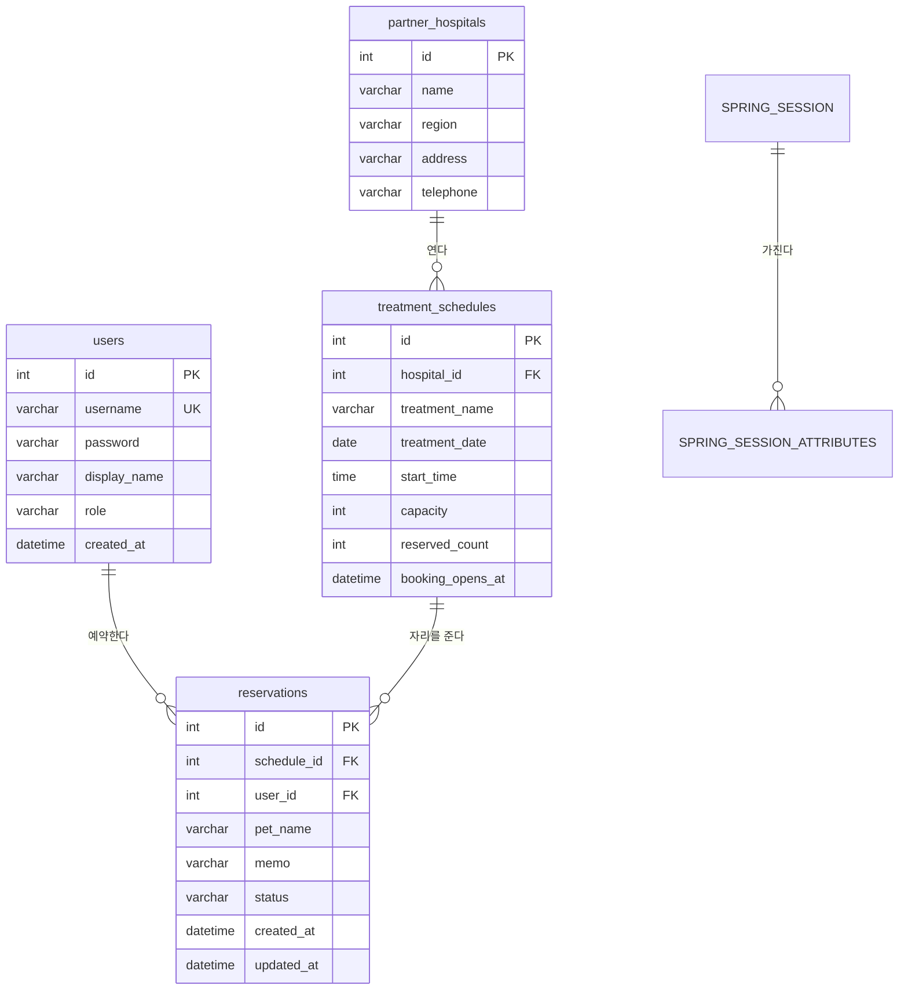

# VetCore 예약 기능 DB 설계

> 2026-11-15 · 대상 DB: MySQL 8.0 (RDS, 중간 프로젝트와 동일) · 스키마 파일: `app/src/main/resources/db/mysql/schema.sql`
> 같은 구조를 H2(테스트용)와 PostgreSQL용 파일에도 넣었습니다.
> 근거 표기: 📝 팀 기획 · 🔍 코드·실행으로 확인 · ⚠️ 미검증

## 1. 테이블 관계



기존 PetClinic 테이블 7개(`owners`, `pets`, `types`, `visits`, `vets`, `specialties`, `vet_specialties`)는 바꾸지 않았습니다. 새 테이블과 외래 키로 연결하지도 않았습니다.

## 2. 새 테이블

### users — 로그인 계정

| 컬럼 | 형식 | 제약 | 설명 |
| --- | --- | --- | --- |
| id | INT UNSIGNED | PK, 자동 증가 | |
| username | VARCHAR(30) | NOT NULL, UNIQUE | 로그인 아이디 |
| password | VARCHAR(100) | NOT NULL | BCrypt 해시 (60자) |
| display_name | VARCHAR(30) | NOT NULL | 화면 표시 이름 |
| role | VARCHAR(20) | NOT NULL | `USER`(보호자) 또는 `STAFF`(직원) |
| created_at | DATETIME | NOT NULL | |

- 보호자(`owners`)와 연결하지 않았습니다. 원본의 보호자는 병원 직원이 등록하는 고객 정보이고, 계정은 예약자 본인이 만드는 것이라 주체가 다릅니다.

### partner_hospitals — 협약 병원

| 컬럼 | 형식 | 제약 | 설명 |
| --- | --- | --- | --- |
| id | INT UNSIGNED | PK, 자동 증가 | |
| name | VARCHAR(80) | NOT NULL | |
| region | VARCHAR(30) | NOT NULL, INDEX | 지역 필터에 사용 |
| address | VARCHAR(255) | | |
| telephone | VARCHAR(20) | | |

### treatment_schedules — 치료 일정

| 컬럼 | 형식 | 제약 | 설명 |
| --- | --- | --- | --- |
| id | INT UNSIGNED | PK, 자동 증가 | |
| hospital_id | INT UNSIGNED | NOT NULL, FK → partner_hospitals | |
| treatment_name | VARCHAR(80) | NOT NULL | |
| treatment_date | DATE | NOT NULL, INDEX | |
| start_time | TIME | NOT NULL | |
| capacity | INT | NOT NULL | 정원 |
| reserved_count | INT | NOT NULL, 기본 0 | 현재 예약 수 |
| booking_opens_at | DATETIME | NOT NULL | 예약 오픈 시각 (Asia/Seoul 기준) |

- `CHECK (reserved_count >= 0 AND reserved_count <= capacity)`

### reservations — 예약

| 컬럼 | 형식 | 제약 | 설명 |
| --- | --- | --- | --- |
| id | INT UNSIGNED | PK, 자동 증가 | |
| schedule_id | INT UNSIGNED | NOT NULL, FK → treatment_schedules | |
| user_id | INT UNSIGNED | NOT NULL, FK → users, INDEX | |
| pet_name | VARCHAR(30) | NOT NULL | |
| memo | VARCHAR(255) | | |
| status | VARCHAR(20) | NOT NULL | `BOOKED` 또는 `CANCELLED` |
| created_at | DATETIME | NOT NULL | |
| updated_at | DATETIME | NOT NULL | |

- `UNIQUE (schedule_id, user_id)`

### SPRING_SESSION, SPRING_SESSION_ATTRIBUTES — 로그인 세션

Spring Session JDBC의 표준 테이블 구조입니다. 앱이 직접 다루지 않고 프레임워크가 읽고 씁니다. 만료된 세션은 프레임워크가 주기적으로 지웁니다.

## 3. 설계 결정과 근거

### 예약 수를 일정 행에 저장한다 (`reserved_count`)

- 예약할 때마다 `COUNT(*)`로 세지 않고 일정 행의 숫자를 올립니다.
- **근거:** 정원 확인과 증가를 UPDATE 한 문장으로 끝낼 수 있습니다. 그래야 여러 Pod가 동시에 요청해도 DB가 정원을 지킵니다. `COUNT(*)` 후 INSERT 방식은 두 단계 사이에 다른 요청이 끼어들 수 있습니다. 자세한 비교는 기능 명세 4장에 있습니다.
- **비용:** `reserved_count`와 실제 `BOOKED` 행 수가 어긋날 가능성이 생깁니다. 두 값은 항상 같은 트랜잭션에서 바뀌므로 정상 동작에서는 어긋나지 않습니다 🔍 동시 요청 테스트에서 두 값 일치 확인. 점검용 쿼리는 5장에 있습니다.
- 한 일정에 요청이 몰리면 그 일정 행 하나에 쓰기가 집중됩니다. 피크 부하에서 이 행 잠금 대기가 얼마나 되는지는 부하 테스트로 확인해야 합니다 ⚠️.

### `CHECK` 제약으로 초과를 DB에서도 막는다

- **근거:** 앱 코드에 버그가 있거나 누군가 직접 SQL을 실행해도 정원을 넘을 수 없습니다. MySQL은 8.0.16부터 CHECK 제약을 실제로 검사합니다. 그보다 낮은 버전은 무시하므로 RDS 엔진 버전을 확인해야 합니다 ⚠️.

### 한 사람은 한 일정에 한 행 (`UNIQUE (schedule_id, user_id)`)

- **근거:** 같은 사용자가 예약 버튼을 연달아 눌러도 DB가 한 건만 받습니다 🔍.
- 취소한 뒤 다시 예약하면 새 행을 만들지 않고 기존 행의 상태를 `BOOKED`로 되돌립니다. MySQL에는 "취소되지 않은 행만 유일"하게 하는 부분 유일 키가 없어서 이렇게 했습니다.
- **잃는 것:** 같은 일정의 취소·재예약 이력이 한 행에 덮어써집니다. 이력이 필요하면 별도 이력 테이블이 필요합니다.

### 취소는 행을 지우지 않고 상태를 바꾼다

- **근거:** 사용자가 "내 예약"에서 취소 내역을 볼 수 있고, 장애 전환 뒤 데이터가 맞는지 대조할 때 취소도 흔적이 남습니다.

### 세션 테이블을 같은 DB에 둔다

- **근거:** 여러 Pod가 로그인 상태를 공유합니다. 그리고 RDS → Cloud SQL 복제에 세션도 함께 실리므로, GCP로 전환한 뒤 재로그인이 필요 없을 것으로 기대합니다 📝 ⚠️ 실제 전환에서는 미검증.
- **비용:** 로그인한 요청마다 세션 갱신 쓰기가 생기고, 그만큼 복제량도 늘어납니다.
- 세션 테이블은 프레임워크의 자동 생성 대신 `schema.sql`에 `IF NOT EXISTS`로 넣었습니다. Pod 여러 개가 동시에 시작해도 안전하게 하려는 것입니다.

### 시각은 시간대 없는 `DATETIME`, 기준은 Asia/Seoul

- **근거:** MySQL `TIMESTAMP`는 접속 시간대에 따라 값이 바뀌어 보입니다. `DATETIME`은 넣은 값 그대로입니다. 앱이 Asia/Seoul 시계로 값을 만들고 비교하므로, AWS와 GCP의 서버 시간대가 달라도 결과가 같습니다.

### 기본 키는 원본과 같은 자동 증가 정수

- **근거:** 원본 PetClinic의 방식을 따랐습니다.
- **DR에서 주의:** 쓰기 DB는 항상 한쪽뿐입니다(Active-Passive 📝). Cloud SQL을 승격한 뒤 자동 증가 값이 마지막 값 다음부터 이어지는지 전환 리허설에서 확인해야 합니다 ⚠️.

## 4. 시드 데이터

| 대상 | 내용 |
| --- | --- |
| 협약 병원 | 6곳 (서울 2, 부산·대구·광주·대전 각 1). 모두 가상의 이름과 주소 |
| 치료 일정 | 12건. 병원마다 2026-12-23과 2027-01-20 각 1건 |
| 정원 | 300, 100, 50, 30, 30, 5. 정원 5짜리는 마감 시연용 |
| 예약 오픈 | 12월분은 2026-11-02 10:00 (이미 오픈), 1월분은 2026-12-18 10:00 (리허설 첫날 오전) |
| 계정 | 시드에는 없음. 보호자는 `/signup`으로, 직원은 환경 변수(`PETCLINIC_STAFF_USERNAME`, `PETCLINIC_STAFF_PASSWORD`)로 만듭니다 |

MySQL용 시드는 `INSERT IGNORE`와 고정 id를 써서, Pod가 다시 시작해도 중복으로 들어가지 않습니다. 같은 이유로 **이미 들어간 행은 시드 파일을 고쳐도 바뀌지 않습니다.** 오픈 시각이나 정원은 관리 화면(`/admin/schedules`)에서 고칩니다.

## 5. 운영용 쿼리

**예약 수와 실제 예약 행이 맞는지 점검** (결과가 없어야 정상):

```sql
SELECT s.id, s.reserved_count, COUNT(r.id) AS booked_rows
  FROM treatment_schedules s
  LEFT JOIN reservations r ON r.schedule_id = s.id AND r.status = 'BOOKED'
 GROUP BY s.id, s.reserved_count
HAVING s.reserved_count <> COUNT(r.id);
```

**장애 전환 뒤 유실 확인용** (전환 직전과 직후에 양쪽에서 실행해 비교):

```sql
SELECT COUNT(*) AS reservations, MAX(id) AS last_id, MAX(updated_at) AS last_change
  FROM reservations;
```

**리허설 전 예약 초기화:**

```sql
DELETE FROM reservations;
UPDATE treatment_schedules SET reserved_count = 0;
```

## 6. 복제(RDS → Cloud SQL)와의 관계

- 모든 새 테이블에 기본 키가 있습니다. 행 단위 복제에 필요합니다.
- 앱이 시작할 때 스키마와 시드 스크립트를 실행합니다. **대기 중인 GCP 쪽 앱은 복제본(읽기 전용)에 연결되므로 이 스크립트가 실패할 수 있습니다** ⚠️. GCP 쪽은 `spring.sql.init.mode=never`로 끄는 것을 권합니다.
- 같은 이유로, 승격 전의 GCP 앱은 세션 쓰기도 할 수 없어 로그인 요청이 실패합니다. 전환 절차에서 "승격 후 트래픽 전환" 순서를 지켜야 합니다 ⚠️.

## 7. 검증 상태

| 항목 | 상태 |
| --- | --- |
| H2에서 스키마 생성과 전체 테스트 | 🔍 통과 (103건, 실패 0) |
| MySQL 8.0에서 스키마 생성 | ⚠️ 미검증. 작업 환경에서 DB 컨테이너를 실행할 수 없었습니다 |
| PostgreSQL에서 스키마 생성 | ⚠️ 미검증 |
| CHECK 제약이 초과를 막는지 | ⚠️ MySQL에서 미검증 |
