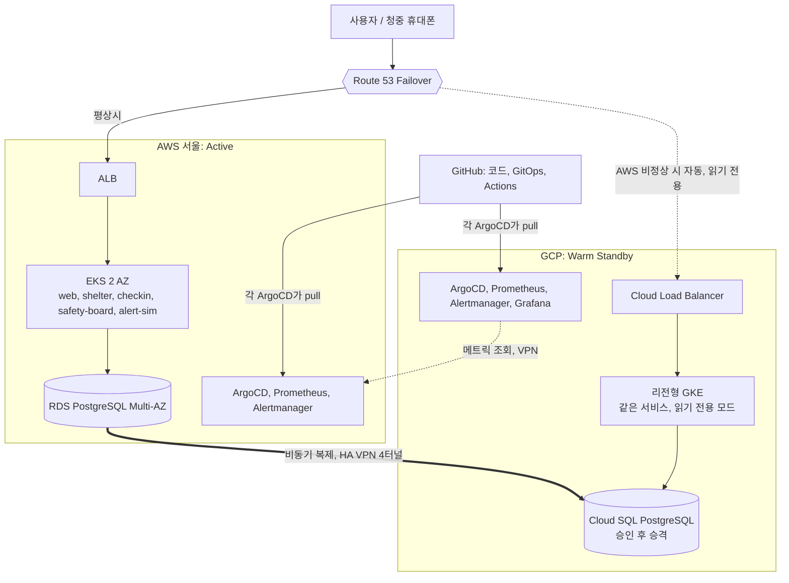

# 최종 프로젝트 계획: 재난 안부·대피소 서비스 "안부"(가칭)

> 팀 공유용 정리본입니다. 서비스 이름은 가칭입니다.
> RTO/RPO와 소요 시간, 비용은 모두 **실측 전 목표치나 추정치**입니다.
> 근거와 대안 비교는 `docs/architecture-proposals/`에 있습니다.

## 1. 한눈에 보기

| 항목 | 내용 |
|---|---|
| 기간 | 2026-11-20(금) ~ 2026-12-21(월) |
| 개발·구성 종료 | 2026-12-17(목). 이후 리허설과 발표 |
| 팀 | 5명 |
| 클라우드 운영 시간 | 09:20 ~ 21:00. 21:00 이후 과금 리소스 종료 |
| 구성 | AWS(Active) + GCP(Warm Standby), Kubernetes MSA, 3Tier |
| 도구 | Terraform, Ansible, GitHub Actions(CI), ArgoCD(CD), Prometheus + Grafana |
| 핵심 메시지 | 재난 때 가장 필요한 서비스는 클라우드 장애 중에도 살아 있어야 한다 |

## 2. 서비스 소개

재난이 났을 때 시민이 쓰는 모의 서비스입니다.

- 가까운 대피소와 남은 수용 인원을 확인합니다.
- 대피소에 입소 체크인을 합니다. 정원은 초과되지 않습니다.
- 가족 코드로 안부 메시지를 남기고 확인합니다.
- 운영자가 모의 재난 문자를 발송합니다.

**이 주제를 고른 이유**

- "왜 멀티클라우드인가"에 대한 답이 서비스 성격에서 바로 나옵니다.
- 장애 중 읽기 전용 모드가 "대피소 정보는 계속 보인다"로 자연스럽게 설명됩니다.
- 체크인의 정원 제한이 "왜 쓰기를 자동으로 넘기지 않는가"의 근거가 됩니다. 양쪽에서 동시에 쓰면 정원이 초과됩니다.

**원칙**

- 로그인은 없습니다. 가족 코드와 기기 토큰만 씁니다.
- 개인정보는 받지 않습니다.
- 화면에 "시연용이며 실제 재난 대응에 사용할 수 없습니다"를 표시합니다.

## 3. MSA 서비스

| 서비스 | 책임 | DB 스키마 | GCP 읽기 전용 모드 |
|---|---|---|---|
| `shelter` | 대피소 위치, 수용 인원, 혼잡도 조회 | `shelter` | 정상 동작 |
| `checkin` | 입소 처리, 정원 초과 방지 | `checkin` | 503과 안내 문구 |
| `safety-board` | 가족 코드로 안부 메시지 작성·조회 | `safety` | 기존 메시지만 조회 |
| `alert-sim` | 모의 재난 문자 발송, 부하 발생 | `alert` | 과거 문자만 조회 |
| `web` | 프런트엔드 (정적 파일, 양쪽 클러스터에 배포) | 없음 | 읽기 전용 배너 표시 |

**구현 규칙**

- 서비스 간 통신은 동기 HTTP만 씁니다. Kafka와 Redis는 쓰지 않습니다.
- 각 서비스는 자기 스키마만 접근합니다. DB 인스턴스는 클라우드별로 1개입니다.
- **모든 테이블의 기본 키는 UUID입니다.** 논리 복제는 시퀀스 값을 따라가지 않으므로, 전환 후 키 충돌을 막기 위한 규칙입니다.
- 체크인은 클라이언트가 만든 UUID로 요청합니다. 그래야 전환 중 재시도해도 중복 입소가 생기지 않습니다.
- 정원 확인은 `SELECT ... FOR UPDATE`로 처리합니다.
- 사이트 모드(`readonly` / `readwrite`)는 Git이 관리하는 ConfigMap으로 주입합니다.
- 각 서비스는 항상 자기 사이트의 DB에만 연결합니다.

**대피소 데이터**

- 행정안전부 민방위대피시설 API를 씁니다. 시설명, 좌표, 최대 수용인원이 들어 있습니다.
- 개발 초기에 한 번 받아 DB 시드로 넣습니다. 시연 중에는 외부 API에 의존하지 않습니다.
- 좌표계가 EPSG:5174라서 위경도로 변환해야 합니다.

## 4. 아키텍처

### 주요 결정

| 영역 | 결정 | 이유 |
|---|---|---|
| 역할 분담 | AWS Active, GCP Warm Standby | 쓰기 지점을 하나로 유지해 데이터 충돌을 원천 차단 |
| DNS | Route 53 Failover 레코드 | 평상시 GCP로 사용자 트래픽이 가지 않아야 함 |
| DB 복제 | Google DMS 연속 작업 (1주차 PoC로 확정) | 승격 전 대상이 읽기 전용이라 실수로 쓰는 것을 막고, 승격 절차가 정해져 있음 |
| ArgoCD | 클러스터마다 독립 인스턴스 | AWS 장애 시에도 GCP 배포 수단이 남음 |
| Grafana | GKE에 배치 | AWS가 죽어도 상황판이 보여야 함 |
| 이미지 | ECR과 Artifact Registry에 같은 digest로 게시 | AWS 장애 시 GKE가 이미지를 받을 수 있어야 함 |
| Terraform state | AWS는 S3, GCP는 GCS | AWS 장애 중에도 GCP 쪽을 다룰 수 있어야 함 |
| 배포 | 롤링 업데이트 + Git revert 롤백, AWS 먼저 GCP 나중 | 4주 일정. 잘못된 배포가 양쪽에 동시에 퍼지지 않게 함 |
| 시크릿 | External Secrets Operator + 각 클라우드 Secret Manager | Git에는 참조만 저장 |
| CI 인증 | GitHub OIDC (AWS IAM, GCP Workload Identity Federation) | 장기 키를 저장하지 않음 |
| 이미지 스캔 | Trivy, HIGH/CRITICAL이면 차단 | |

### 일부러 빼는 것

| 제외 | 이유 |
|---|---|
| 액티브-액티브, 분산 DB | 일정 내 운영 불가, 정원 초과 위험 |
| 서비스 메시, 클러스터 간 호출 | 평상시 클라우드 간 통신이 없어 필요 없음 |
| Argo Rollouts, Thanos, Loki | 4주 일정. 시간이 남으면 Rollouts부터 추가 |
| Kafka, Redis | 멀티클라우드 복제 대상이 늘어남 |
| Cloudflare | 사업자가 하나 늘어남. Route 53이 AWS에 의존한다는 약점은 발표 때 명시 |
| 자동 복귀(failback) | 계획 작업으로 처리. 시연에서는 Terraform 재구성으로 대신함 |

### 역할 경계

| 도구 | 담당 |
|---|---|
| Terraform | 클라우드 리소스: VPC, EKS, GKE, RDS, Cloud SQL, VPN, Route 53, IAM |
| Ansible | 순서가 있는 절차: ArgoCD 부트스트랩, DB 준비, `failover.yml`, `failback.yml` |
| ArgoCD | 클러스터 안의 모든 것: 앱, 모니터링 스택, External Secrets |

## 5. 장애 전환 방식

### 2단계 전환

1. **자동 단계:** Route 53 헬스체크가 AWS 실패를 감지하면 DNS를 GCP로 넘깁니다. GCP는 읽기 전용이라 조회는 되고 체크인은 막힙니다. AWS가 스스로 복구되면 DNS도 돌아오고, 데이터에는 영향이 없습니다.
2. **승인 단계:** 알람과 복제 지연 값을 확인한 사람이 failover를 승인합니다. 그러면 Cloud SQL 승격, `active-site=gcp` 커밋, ArgoCD 동기화가 이어지고 체크인이 다시 열립니다.

쓰기를 자동으로 넘기지 않는 이유는 오탐 한 번으로 양쪽이 모두 쓰기 가능해지기 때문입니다. 그러면 대피소 정원이 초과됩니다.

**주의할 점:** 승격 후 AWS가 살아나면 Route 53이 트래픽을 낡은 DB 쪽으로 되돌릴 수 있습니다. 두 겹으로 막습니다.

- failover 절차가 헬스체크를 항상 실패하도록 바꿉니다.
- AWS의 ArgoCD가 `active-site=gcp`를 동기화하면 AWS 앱이 읽기 전용으로 바뀝니다.

### 시나리오별 목표 (실측 전)

| 시나리오 | 자동 동작 | 사람의 조치 | RTO 목표 | RPO 목표 |
|---|---|---|---|---|
| 파드 / 노드 장애 | 재스케줄, ALB 대상 제외 | 없음 | 1분 | 0 |
| AZ 장애 | 2 AZ 분산, RDS Multi-AZ 전환 | 없음 | 3분 | 0 |
| AWS 전체 장애 | DNS가 GCP로 전환, 읽기 전용 | 승인 후 쓰기 개방 | 읽기 3분, 쓰기 15분 | 1분 이내 (보장 아님) |
| 잘못된 배포 | 알람 | Git revert | 15분 | 0 |
| VPN 단절 | 서비스 영향 없음, 알람 | 터널 복구 | 해당 없음 | 복구 전까지 스탠바이가 뒤처짐 |

## 6. 하루 운영 주기

| 시각 | 작업 |
|---|---|
| 09:20 | 당번이 기동 워크플로를 실행합니다. 클러스터, NAT, VPN을 만들고 DB를 시작합니다 |
| ~10:20 (추정) | ArgoCD가 Git에서 앱과 모니터링을 복원합니다. 복제가 재개됐는지 확인합니다 |
| 낮 | 작업합니다. 앱 개발은 Docker Compose나 kind로 로컬에서도 할 수 있습니다 |
| 20:20 | 종료를 시작합니다. Ingress 삭제 → 복제 지연 0 확인 → DB 중지 → 클러스터, NAT, VPN 삭제 순서입니다 |
| 21:00 전 | 잔여 리소스를 점검하고 팀 채널에 결과를 보고합니다 |

**당번 규칙**

- 매일 한 명이 기동과 종료를 맡고, 순번으로 돌립니다.
- 기동·종료 소요 시간과 실패 내용을 기록합니다. 이 기록은 발표 근거로 씁니다.
- GitHub 예약 실행은 몇 시간씩 늦은 사례가 있어 수동 실행을 기본으로 합니다. 예약 실행은 안전장치로만 둡니다.
- Terraform 삭제 전에 반드시 Ingress부터 지웁니다. Kubernetes가 만든 LB와 ENI가 남으면 삭제가 막힙니다.

### 21:00 이후에도 남기는 리소스 (팀 확인 필요)

소액이지만 과금됩니다. 지우면 다음 날 복구할 수 없습니다.

- Terraform state 버킷 (S3, GCS)
- 이미지 레지스트리 (ECR, Artifact Registry)
- Route 53 호스팅 영역, 인증서, 시크릿
- GCP 고정 IP
- 중지된 RDS와 Cloud SQL의 디스크
- VPC (NAT 제외)

### 비용 (추정, 미검증)

- 전체 구성 기준 시간당 약 $1.55입니다.
- 하루 11시간 40분씩 11-20~12-21에 평일만 가동하면 약 $400, 매일 가동하면 약 $580입니다.
- 보관 리소스 비용은 별도입니다.
- 양쪽 클라우드에 예산 알림을 설정합니다. 삭제 누락이 가장 큰 비용 사고 원인입니다.

## 7. 일정

| 기간 | 목표 | 완료 기준 |
|---|---|---|
| ~11-19 준비 | 계정, 할당량, 도메인, 역할, CIDR 확정 | 11-20에 바로 Terraform 시작 가능 |
| 1주 11-20 ~ 11-26 | 네트워크, VPN, DB, **복제 PoC**, 앱 뼈대, CI | RDS 변경이 Cloud SQL에 보임. 11-26까지 복제 방식 결정 |
| 2주 11-27 ~ 12-03 | EKS, GKE, ArgoCD, 기동·종료 워크플로, 서비스 4개 초안 | 버튼 하나로 양쪽 재생성, AWS에서 체크인 성공 |
| 3주 12-04 ~ 12-10 | 모니터링, 상황판, 읽기 전용 모드, Route 53, failover 플레이북 | **12-07 스키마 동결**, 12-10까지 첫 전체 failover 성공 |
| 4주 12-11 ~ 12-17 | RTO/RPO 실측 3회 이상, 결함 수정, 런북 정리 | **12-16 코드 동결**, 전원이 한 번씩 failover 실행 |
| 12-18 ~ 12-21 | 리허설, 녹화본, 발표 | 리허설 3회, 백업 영상 확보 |

스키마 동결이 필요한 이유는 DDL이 자동으로 복제되지 않기 때문입니다.

**일정이 밀리면 줄이는 순서:** `alert-sim` → 유실 측정 기능 → VPN을 통한 Grafana 교차 조회 → DB 복제를 백업 복원으로 대체

**끝까지 지킬 것:** 읽기 자동 전환, 승인 후 쓰기 복구, 상황판

## 8. 역할

담당자 배정은 팀에서 정합니다.

| 역할 | 담당 범위 |
|---|---|
| A. AWS | Terraform: VPC, EKS, RDS, Route 53 |
| B. GCP·네트워크 | Terraform: VPC, GKE, Cloud SQL. VPN, DB 복제 |
| C. 플랫폼 | GitHub Actions, ArgoCD, 기동·종료 워크플로 |
| D. SRE | Prometheus, Grafana, 알람, Ansible failover, k6 부하 테스트 |
| E. 앱 | 서비스 4개, 프런트엔드. 3주차부터 C, D가 지원 |

## 9. 위험과 1주차 PoC

**가장 큰 위험: 매일 DB를 중지하고 VPN을 삭제해도 복제가 유지되는가**

DMS는 중지한 작업의 재개를 지원합니다. 하지만 양쪽 DB 중지와 VPN 삭제가 겹친 경우는 확인하지 못했습니다. **DMS의 Restart는 대상 데이터를 지울 수 있으니 복구 수단으로 쓰면 안 됩니다.**

11-26까지 아래 순서로 시험해 결정합니다.

1. DMS 작업을 매일 중지·재개하며 유지합니다.
2. 1번이 안 되면 매일 아침 Cloud SQL과 DMS를 새로 구성합니다. 데이터가 작아 현실적입니다.
3. 2번도 어려우면 복제를 포기하고 백업 복원 방식으로 바꿉니다. 이 경우 RPO가 크게 늘어납니다.

| 그 밖의 위험 | 대응 |
|---|---|
| Cloud SQL이 VPN을 거쳐 사설 경로로 연결되는지 확인 안 됨 | 1주차 PoC에 포함 |
| RDS 시작이 수 분에서 수 시간까지 걸릴 수 있음 (AWS 문서) | 매일 시작 시간을 기록하고, 발표일에는 일찍 기동 |
| ALB 주소가 매일 바뀜 | Route 53 레코드와 헬스체크 갱신을 기동 절차에 포함 |
| Prometheus 데이터가 매일 사라짐 | SLO는 당일 세션 지표로 대체. 실측 결과는 따로 보관 |
| 앱 담당 1명이 병목 | 서비스 범위를 작게 유지, 3주차부터 지원 |
| Route 53이 AWS에 의존 | 막지 못하는 약점으로 발표 때 명시 |

## 10. 시연 시나리오 (약 7분)

| 순서 | 동작 | 관객에게 보이는 것 |
|---|---|---|
| 1 | 청중이 QR로 접속해 모의 대피자로 체크인 | 체크인이 AWS로 들어가고 복제 지연이 수 초로 표시됨 |
| 2 | AWS 장애를 모의 실행 | 오류율 급증, 상황판의 AWS 패널이 비어 감 |
| 3 | 1~2분 대기 | DNS가 GCP로 전환되고, 청중 휴대폰에 대피소 정보가 다시 보임 |
| 4 | 체크인 시도 | 읽기 전용 안내. 의도된 동작임을 설명 |
| 5 | 알람과 복제 지연을 확인하고 failover 승인 | 승인 화면 |
| 6 | Cloud SQL 승격, ArgoCD 동기화 | 체크인 재개 |
| 7 | 전환 직전 기록과 비교 | 실측 RTO와 RPO 공개 |

- 실제 리전을 끌 수는 없으므로 **시뮬레이션임을 명시**합니다.
- 장애 주입 스크립트를 ArgoCD self-heal이나 LB 컨트롤러가 되돌리지 않는지 리허설에서 확인합니다.
- 청중 휴대폰은 DNS 캐시 때문에 늦게 전환될 수 있습니다. 측정은 k6 부하로 따로 합니다.
- 라이브 시연이 실패하면 녹화본으로 전환합니다.

**발표 포인트:** 매일 전체 환경을 코드로 다시 만드는 운영 자체가 복구 훈련입니다. 재구성 횟수와 소요 시간을 근거로 제시합니다.

## 11. 팀이 정해야 할 것

- [ ] 21:00 이후 6장의 보관 리소스를 남겨도 되는지
- [ ] 주말에도 가동하는지
- [ ] GCP 리전: 서울(`asia-northeast3`)과 도쿄(`asia-northeast1`) 중 선택
  - 같은 도시 재해까지 고려하면 재난 서비스 주제에 맞게 도쿄를 권장합니다.
  - 도쿄로 가면 복제 지연을 1주차에 측정해야 합니다.
- [ ] 12-21 발표 시각. 기동에 1시간 이상 걸릴 수 있습니다
- [ ] 서비스 이름
- [ ] 역할별 담당자

## 참고

- 세 설계안 원문: `docs/architecture-proposals/claude.md`, `codex.md`, `antigravity.md`
- 비교 보고서: `docs/architecture-proposals/comparison.html`
- 4주 기준 수정안: `docs/architecture-proposals/recommended-plan.html`
- [행정안전부 민방위대피시설 API](https://www.data.go.kr/data/15155067/openapi.do)
- [Google DMS 작업 관리](https://docs.cloud.google.com/database-migration/docs/postgres/migration-job-actions)
- [Amazon RDS 인스턴스 임시 중지](https://docs.aws.amazon.com/AmazonRDS/latest/UserGuide/USER_StopInstance.html)
